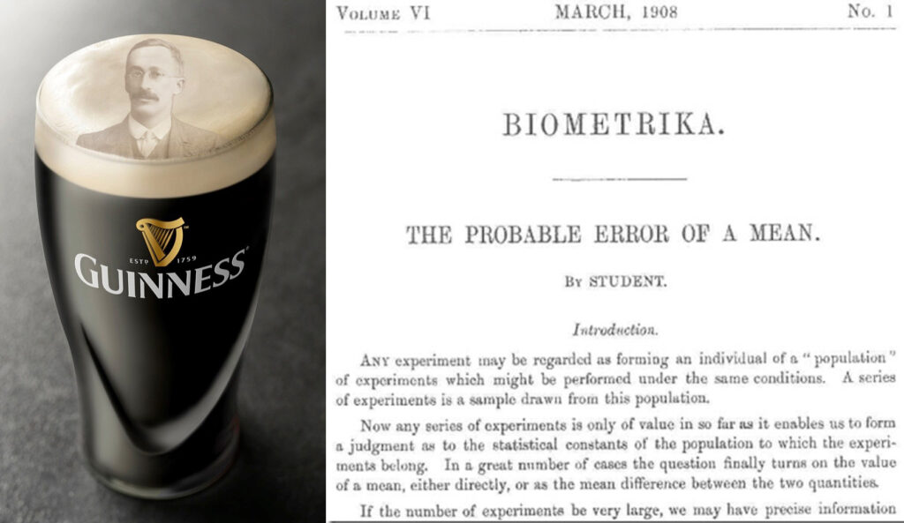

## Course objectives and teaching philosophy

The main objective of this course are to help you acquire or improve your statistical common sense, and to help you analyse data. You have likely had at least one course in statistics before, but without the opportunity to practice with real-world data, you may have had difficulty connecting the concepts to any meaningful biological inference.

We are not real statisticians teaching this course, simply practicing biologists who use statistics almost daily. This background influences the way we teach, which is grounded in examples and application—**the 'how' of statistics**. At times it may be useful to sign-post some of the more theoretical aspects of statistics—**the 'why' of statistics**—so that we may understand when to use certain statistical approaches appropriately.

------------------------------------------------------------------------

## Why do we do statistics?

::: {.content-visible when-format="html" unless-format="revealjs"}
Biologists rarely set out to become statisticians. We are drawn to the natural world—to microbes, plants, animals, ecosystems, diseases—and to the puzzles of how they function. But as soon as we start asking scientific questions, we run into a problem. **Biology is messy.** No two cells grow exactly the same, no two animals behave identically, and no two experiments give identical results.
:::

Statistics serve two main purposes:

- **Inferential**: assess whether observed differences are real or due to chance.  
- **Descriptive**: summarise and communicate data.  

Proper statistical knowledge is key to experimental design; poor knowledge leads to wasted effort and unreliable conclusions.

::: {.content-visible when-format="revealjs"}
## Why do we do statistics?
:::

### Convincing ourselves and others (inferential statistics)

- Because biological systems vary, repeating the same experiment can yield variable results.  
- Statistics provides a way to estimate the probability that results are due to random chance.  
- The common procedure is to calculate the probability that observed results could have happened by chance alone. If this is small, it is reasonable to conclude that the differences resulted from some treatment rather than from random variation.  
- Statistics provides the rules for estimating this probability, and for drawing conclusions from it (making an *inference*).  

::: {.content-visible when-format="revealjs"}
## Why do we do statistics?
:::

### Transmitting information (descriptive statistics)

- Statistics is also used to summarise data (*describing* an effect). Modern good practice is to include raw data with any publication, but obtaining meaningful insight from raw data can sometimes be difficult.  
- There are many ways of summarising data (e.g. means, standard deviations) for different purposes. We will look at these during the unit.  
- It is important to recognise that these descriptors simplify communication but lose detail—one cannot fully reconstruct the data from summary statistics alone.  


::: {.content-visible when-format="revealjs"}
## Why do we do statistics?
:::

### Designing effective experiments

- By combining expected variability and desired effect size, statistics can tell you how many replicates are needed.  
- Sometimes they even reveal that an experiment is unlikely to ever show an effect, saving time and resources.  


::: {.content-visible when-format="revealjs"}
## Why do we do statistics?
:::

::::: columns
::: {.column width="50%"}
### What statistics can do for you

-   Provide objective criteria for evaluating biological hypotheses
-   Help you critically evaluate the arguments of others
-   Help optimise your efforts through informing experimental design
:::

::: {.column .fragment width="50%}

### What statistics can’t do for you

- Prove objective “truth”: statistics estimate probabilities and uncertainty, not certainties.
- Indicate biological importance: statistical significance ≠ biological significance
- Fix poor experimental design: no analysis can compensate for bad planning, missing controls, or poor data quality (“garbage in, garbage out”).

:::
::::

------------------------------------------------------------------------

## A brewer’s problem of quality control

::::: columns
::: {.column width="40%"}
 
William Sealy Gosset was employed by Guinness to apply science to quality control in beer production.

He needed a method for testing whether estimates from a small *sample* of the batch were evidence for the *entire* batch being high-quality.

For this, he invented the *t*-test:

$$ t = \frac{\bar{x}-\mu_0}{s/\sqrt{n}}$$
:::

::: {.column width="60%"}
This tells us whether the average of the sample ($\bar{x}$), given the standard deviation of the sample ($s$) and the sample size ($n$), differs from a hypothesised *true mean* $\mu_0$


The *t*-test remains one of the most widely used tools in biology today.\



:::
:::::

## The "Lady tasting tea" experiment

::::: columns
::: {.column width="60%"}
One afternoon at Rothamsted, Dr. Ronald A. Fisher poured a cup of tea. Dr. Muriel Bristol declined, saying she preferred when the **milk was poured first**.

Dr. Fisher replied: *“Nonsense — surely it makes no difference.”* But Dr. Bristol insisted she could tell.

A colleague suggested: *“Let’s test her.”*

:::{.fragment}
They quickly set up an experiment:

-   8 cups of tea were prepared.\
-   4 had milk poured first.\
-   4 had tea poured first.\
-   The cups were presented in random order.
:::

:::

::: {.column width="40%"}
Dr. Bristol was told the design: 4 had milk added first, 4 had tea added first.\
Her task: **identify which was which.**

](images/tea-cups.jpg)
:::
:::::

## Recording results

::::: columns
::: {.column width="70%"}
Each cup has two pieces of information:

1.  The **actual pouring order**.\
2.  The **lady’s judgment**.

We can summarize these in a **contingency table**:

|               | Actual: Tea first | Actual: Milk first | Row total |
|---------------|-------------------|--------------------|-----------|
| **Says Tea**  | *a*               | *b*                | *a* + *b* |
| **Says Milk** | *c*               | *d*                | *c* + *d* |
| **Col total** | *a* + *c*         | *b* + *d*          | *n*       |
:::

::: {.column width="30%"}
By the design of the experiment, she **must classify 4 as tea-first, and 4 as milk-first**. This fixes the row and column totals:

$$a+b=4$$ $$c+d=4$$ $$a+c=4$$ $$b+d=4$$

Once $a$ (the number correctly identified tea-first cups) is known, the rest follow.
:::
:::::

## How likely is success by chance?

::::: columns
::: {.column width="50%"}
If she has no ability to discriminate, then choosing 4 cups as “tea-first” is just random.

There are:

-   $\binom{8}{4} = 70$ possible ways she can classify cups.\
-   Only 1 way gives a **perfect score**.

Therefore, the probability of getting a perfect 4/4 correct = **1/70 ≈ 0.014**.

By chance alone, very unlikely!
:::

::: {.column width="50%"}
The number of correct identifications of tea-first cups *a* follows a **hypergeometric distribution**:

| Correct calls, $a$ | Probability, $p$-value |
|--------------------|------------------------|
| 0                  | 1/70                   |
| 1                  | 16/70                  |
| 2                  | 36/70                  |
| 3                  | 16/70                  |
| 4                  | 1/70                   |

If she got:

-   **all 4 correct**, *p*-value = 1/70 ≈ 0.014.\
-   **3 correct**, *p*-value = (1 + 16)/70 ≈ 0.24.
:::
:::::

## Fisher’s insight

::::: columns
::: {.column width="60%"}
This simple trial became the foundation of **Fisher’s exact test**, a method still used today.

Fisher immediately thought about:

-   How many cups should be used?\
-   How should they be randomized?\
-   What counts as convincing evidence?

These are the same questions **we still ask** when thinking about designing experiments, whether or not they have a similar form to the tea experiment. This “trivial” experiment illustrates:

-   The importance of **randomization**.\
-   The use of **contingency tables**.\
-   The logic of **hypothesis testing**.
:::

::: {.column width="40%"}
And it reminds us: statistics is not just numbers, but a way of turning everyday claims into scientific evidence.
:::
:::::

## Example: drug trial in mice

Imagine we are testing a new drug in mice.

-   **Treated group:** average survival = 8 days\
-   **Control group:** average survival = 6 days

At first glance, this looks promising — 2 extra days!\
But we immediately face some questions...

-   Is the difference (8 vs 6 days) a **real biological effect**,\
    or could it just be **random chance**?\
-   How many mice do we need to study before we can be confident?\
-   Which **statistical test** is appropriate for comparing these groups?

These are exactly the same kinds of questions Fisher asked with tea cups.


## Why not just trust the averages?

Suppose:

-   In one small trial, 5 treated mice lived 8, 9, 7, 8, 8 days.\
-   5 control mice lived 6, 6, 7, 5, 6 days.

The averages are 8 vs 6, but notice:

-   Not every treated mouse lived longer.\
-   There is **overlap** between the two groups.

So we need a statistical framework to decide:\
**Is this difference bigger than we’d expect by chance alone?**

Statistics helps us answer:

-   **Signal or noise?** Is the treatment effect real or random variation?\
-   **How strong is the evidence?** Can we quantify the uncertainty?\
-   **How many replicates?** Power analysis tells us how many mice are needed.

------------------------------------------------------------------------

## Linking back to history

The logic is the same whether it’s:

-   Barley yields at Guinness Brewery (Student’s *t*-test).\
-   Lady tasting tea (Fisher’s exact test).\
-   Survival in treated vs control mice.\
-   Your own research projects...

Statistics gives us the tools to turn messy data into reliable evidence. It's not just about “appeasing reviewers” or “getting the *p*-value right.”

It’s about:

-   Designing better experiments.
-   Making sure our conclusions are trustworthy.\
-   Linking our observations to the deeper processes shaping life.

```{=html}
<!--
## What this lecture is about

- Why statistics matter for biology  
- How statistics grew out of biological problems  
- What statistics can (and can’t) do for us  
- Stories of real biologists and statisticians  

---

## Biology is messy

- No two organisms are identical  
- Environments add unpredictable effects  
- Measurements are imperfect  
- Patterns can appear by **chance alone**  

Statistics helps us decide if a pattern is **real** or just **random noise**.  

---

## Historical roots: Guinness Brewery

- Early 1900s: William Sealy Gosset, a chemist at Guinness Brewery  
- Needed to test quality of barley with **small sample sizes**  
- Developed the **t-test** to compare means when data are limited  
- Published under the name **“Student”** → *Student’s t-test*  

**Lesson**: Statistics arose to solve *practical biological problems*  

---

## Fisher’s lady tasting tea

- Ronald A. Fisher, pioneer of experimental design  
- A colleague claimed she could tell if milk or tea was poured first  
- Fisher designed an experiment: 8 cups, 4 with milk-first, 4 tea-first  
- Randomisation ensured fairness  
- Used probability to calculate how likely she could be correct by chance  

**Lesson**: Careful design + probability = fair test of a biological claim  

---

## Statistics as part of science

- Gosset: small-sample inference  
- Fisher: randomisation & experimental design  
- Later: analysis of variance, regression, likelihood  
- All arose to handle **biological variation**  

Biology drove many advances in statistics.  

---

## Example: drug trial in mice

Treated: average survival 8 days  
Control: average survival 6 days  

Questions:  
- Is 8 vs 6 days a real effect or chance?  
- How many mice are needed?  
- Which test should be used?  

→ Same logic as Guinness barley & Fisher’s tea cups!  

---

## What statistics can do

- Help design robust experiments  
- Distinguish real effects from chance  
- Quantify uncertainty  
- Provide a common language to communicate evidence  

---

## What statistics cannot do

- Rescue poor experimental design  
- Eliminate bias in data collection  
- Prove hypotheses true — only evaluate evidence  

---

## Take-home messages

- Biology is full of variation → statistics helps us make sense of it  
- The history of statistics is rooted in biological problems  
- Good biology = design + statistics + interpretation  
- Statistics is not abstract maths: it’s a **language of evidence**  
-->
```
