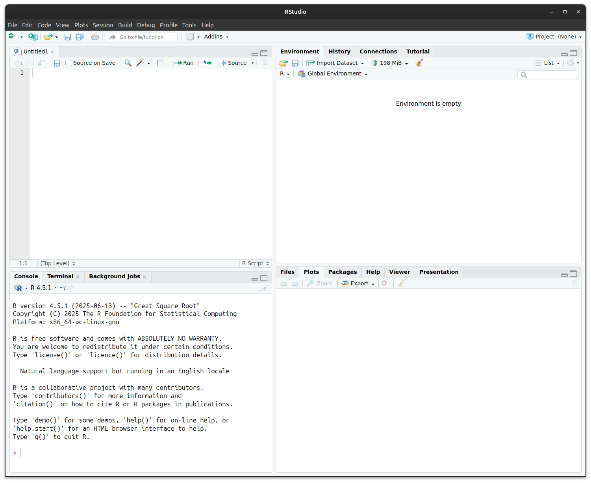

```{r, echo = F, message = F}
library(tidyverse)
```

## Welcome to statistics using R

This course is designed for students in life sciences learning statistics—maybe for the first time ever! It may also be useful as a refresher before taking a more advanced course, or for those who have some familiarity with statistics but have never used R. You may be familiar with spreadsheets or point‐and‐click statistics software like GraphPad Prism, but have not yet used command‐based tools. We will treat programming as a logical set of instructions—much like a laboratory protocol—that you write, share, and revise.

If you’ve never written a line of code before, that’s perfectly fine—think of programming as writing a recipe or a set of instructions. Unlike point‐and‐click tools, R scripts are **reproducible** and **transparent**: anyone can rerun your code and get the same results, or inspect exactly how each number was computed.

---

## Why program instead of click?

-   **Reproducibility**: A script records every step. No more lost settings or hidden menus.
-   **Transparency**: Your analysis is visible in plain text; reviewers can see exactly what you did.
-   **Flexibility**: With code, you can automate repetitive tasks, process large datasets, and customise every step.
-   **Version control**: Scripts work nicely with Git, letting you track changes over time.

In contrast, graphical interfaces may feel easier at first, but they often hide crucial details and make it hard to repeat or share your work.

## More reasons to choose R

-   **Massive community** – millions of users; quick answers on Stack Overflow, R-Studio Community, Bioconductor, etc.
-   **13 000 + CRAN packages** – specialised tools for genomics, ecology, finance, clinical trials, and more.
-   **Career advantage** – R proficiency shows up in data-science, biotech, public-health, and academic job listings.
-   **Free & open source** – zero licence fees (*gratis*), and you can inspect or modify the source code (*libre*).

## R programming language

:::: {.columns}
::: {.column width="70%"}
R is a programming language and environment specifically designed for statistical computing and data analysis. It provides:

-   A comprehensive set of statistical tools, from basic descriptive summaries to advanced modeling.
-   Packages that extend R's functionality contributed by the community, covering specialties from ecology and genomics to finance and social science.
-   A flexible scripting interface: you write commands that can be saved, shared, and rerun exactly as you wrote them.
-   Built-in graphics, enabling publication-quality visualisations with fine control over every element.
:::

::: {.column width="30%"}
](images/R.png){style="max-width: 200px;"}

:::
::::

---

## RStudio interface

:::: {.columns}
::: {.column width="40%"}
RStudio is a user-friendly interface for working with R. It brings together:

-   **Editor**: where you write and save your code.
-   **Console**: where you run commands and see results immediately.
-   **Environment**: where you can see the data and objects you’ve created.
-   Tabs for files, plots, packages, and help, all in one window.

:::

::: {.column width="60%"}
The RStudio environmnet lets you see your code, files, output etc. all together:


:::
::::

---

## R philosophy: objects, functions and operators

-   Everything in R is an **object**: numbers, text, tables, plots—each is referred to by a name.
-   **Functions** are tools that take objects as input and return new objects as output. For example, `mean(x)` takes a numeric object `x` and returns its average.
-   R has a number of **operators** that let you combine, perform maths, or compare objects.

``` r
# Create a numeric object
x <- c(2, 4, 6, 8) # a 'vector' of 4 numbers
x <- seq(from = 2, to = 8, by = 2) # equivalent to above

# Apply the mean() function to the numeric object x
mean(x)  # returns 5
```

## Special functions in R

Some functions in R are so fundamental that they look a bit different from everyday verbs:

::: {.incremental}
- **`c()`** – *combine* values into a single vector.  
  ```r
  c(1, 2, 3)        # numeric vector
  c("a", "b", "c")  # character vector
  ```

- **`:`** – creates a simple sequence of integers.  
  ```r
  1:5   # 1, 2, 3, 4, 5
  ```

- **`seq()`** – more flexible sequence builder.  
  ```r
  seq(from = 2, to = 10, by = 2)   # 2, 4, 6, 8, 10
  ```

- **`rep()`** – repeat values.  
  ```r
  rep("A", times = 3)   # "A" "A" "A"
  ```
:::

💡 These are often called **“base R” helper functions** — you’ll use them all the time, even when working with more advanced packages.


## Operators in R
::: {.incremental}
-   **Arithmetic operators**: `+`, `-`, `*`, `/` let you do maths\
-   **Logical operators**: `>`, `<`, `==`, `!=` let you ask questions such as “is this value bigger than that one?”\
-   **Pipe operator**: `|>` (or `%>%` in older code) sends the result of one function into the next, making code step-by-step and clear\
-   **Assignment operators**: `<-` or `=` store results in a name
:::

. . . 

Here's how they work:
``` r
# Assignment operators
x <- 10         # Give the name x the value of 10 
y = 5           # = also works for assignment but is discouraged
name <- "Danna" # Text should be enclosed in quotation marks ""


# Arithmetic operators
2 + 3           # 2 plus 3
5 * 4           # 5 times 4, i.e. 5 × 4
10 / 2          # 10 divided by 2, i.e. 10 ÷ 2
2^2             # 2 to the power of 2
x + y           # Adds the value of x and y, i.e. 15

# Logical operators
3 < 2           # Is 3 less than 2? No, returns FALSE
7 != 8          # Is 7 not equal to 8?, Yes, returns TRUE
1 + 3 == 2^2    # Is 1 + 3 equal to 2^2? Yes, returns TRUE. Note the two equals signs!

# Logical operators can also work for text
"Cat" == "Dog"  # Is "Cat" equal to "Dog"? No, returns FALSE
"cat" != "CAT"  # Is lowercase "cat" not equal to uppercase "CAT"? R is case sensitive.

# Pipe operators
c(1, 2, 3, 4, 5) |> mean()   # Mean is equal to 3
c(1, 2, 3, 4, 5) %>% mean()  # Equivalent to above
```

## More on assignment operators

-   **Purpose**: *stores* the value on the right-hand side in the named object on the left
-   **Preferred style**: `<-` (“gets”) is the long-standing R convention; `=` also works in most scripts but can clash inside function calls
-   **Read aloud**: `weight_kg <- 70` 👉 “weight_kg *gets* 70”
-   **Objects are *updated* in place**—re-assigning overwrites the previous value

``` r
# Create an object
weight_kg <- 70

# Overwrite (update) it
weight_kg <- weight_kg + 2   # now 72

# Mixing operators is discouraged for readability
height_m = 1.75
bmi <- weight_kg / height_m^2
```

## Adding comments to your code: `#`

-   A line starting with `#` is **ignored by R**—use it to explain *why* a step exists or *what* it does
-   This is very helpful to your future self when you want to look back and understand what you've done.
-   Place comments **above** or **beside** the line they describe for quick scanning
-   Typical uses
    -   Section headers: `# ---- load data ----`
    -   Clarify non-obvious maths or units
    -   Cite data sources or decisions (“drop outliers \> 3 SD”)

``` r
# Store leaf length data
length_cm <- c(100, 132, 142, 98, 172) # lengths in mm

# Convert to cm and compute mean
length_mm <- length_cm %>%
  mutate(length_cm = length_mm / 10)  # convert mm to cm

mean_len <- mean(length_cm)  # overall mean
```

## Putting it together

:::: {.columns}
::: {.column width="50%"}
Let's look at a simple example of how these are used. Here's an example data set, where we recorded the heights of a sample of 30 students in an undergraduate degree programme:

```{r, echo = T}
# Heights of sample of students in meters (m)
height_m <- c(
  1.56, 1.63, 1.81, 1.69, 1.77,
  1.73, 1.59, 1.73, 1.65, 1.63,
  1.68, 1.50, 1.80, 1.60, 1.78,
  1.68, 1.84, 1.60, 1.64, 1.71,
  1.43, 1.76, 1.84, 1.79, 1.75,
  1.65, 1.81, 1.78, 1.72, 1.68
)
```

We can calculate the mean and standard deviation (SD) of like so:

``` {r, echo = T}
# Compute mean and standard deviation
mean_height <- mean(height_m)  # 1.69
sd_height   <- sd(height_m)    # 0.10
```
The mean and standard deviation of student heights is 1.69±0.10 m.
:::

::: {.column width="50%"}
We can also plot the distribution with a simple histogram.

```{r, echo = T}
hist(height_m)
```

We'll look at a better, more customisable method for plotting in a later workshop.
:::
::::

---

## Working with files in RStudio

- R needs to know **where your files live**  
- This location is called the **working directory**  
- Think of it as the "“"current folder" R looks in when you ask it to read or write a file


## Checking the working directory

- Use `getwd()` to check where R is currently looking  
- Use `setwd("path/to/folder")` to change it (but best practice is to use RStudio Projects instead)

```r
getwd()                # show current directory
setwd("~/BIOL33031")   # set working directory (avoid hard-coding in scripts)
```


## Tab completion

- In RStudio, press **Tab** after typing part of a name to auto-complete
  - For objects you’ve created
  - For function names
  - For file and folder paths
- Helps avoid typos and discover available options

```r
my_long_variable_name <- 42

my_lon   # type this, then press Tab → autocomplete!
```


## Working with files safely

- Always keep your data and scripts in the same **Project folder**
- Avoid using absolute paths like `C:/Users/...` in your code. This makes it less transferrable if you rearrange files or share your code with someone else.
- Use **relative paths** instead, starting from the project root

```r
# Good
data <- read.csv("data/heights.csv")

# Bad
data <- read.csv("C:/Users/YourName/Documents/data/heights.csv")
```

---

## Getting help in R

-   Use `help(mean)` or `?mean` to see function documentation.
-   Use `help(package = "dplyr")` to browse all functions in a package.
-   The Cheatsheets at https://www.rstudio.com/resources/cheatsheets/ are very handy.
-   Google and generative AI (like ChatGPT) are also helpful for finding examples and understanding error messages.

## Next steps

You’ve now set up R, learned the basic grammar of objects and functions. In the next section, we will look at a useful add-on package to R--**the tidyverse**.

::: {.content-visible when-format="html" unless-format="revealjs"}

## ❓Check your understanding

1. **Objects**  
   What does the following line of code do?  
   ```r
   weight_kg <- 65
   ```

   ::: {.callout collapse="true"}
   ## Answer
   It creates an object named `weight_kg` and assigns the value 65 to it.
   :::

2. **Functions**  
   If `x <- c(2, 4, 6, 8)`, what does `mean(x)` return?  

   ::: {.callout collapse="true"}
   ## Answer
   The mean is (2 + 4 + 6 + 8)/4 = 5.
   :::


3. **Operators**  
   Which of the following will return `TRUE`?  
   - `5 == 2 + 3`  
   - `10 < 3`  
   - `7 != 7`  

   ::: {.callout collapse="true"}
   ## Answer
   `5 == 2 + 3` is TRUE; the others are FALSE.
   :::


4. **Pipes**  
   Rewrite this code using the pipe operator `|>`:  
   ```r
   mean(height_m)
   ```

   ::: {.callout collapse="true"}
   ## Answer
   ```r
   height_m |> mean()
   ```
   :::


5. **Comments**  
   Why is it helpful to add comments (`#`) to your R code?  
   What comment would you give to this code block? `height_m <- height_cm / 100`

   ::: {.callout collapse="true"}
   ## Answer
   Comments explain what the code does and why, making it easier to understand later.  
   Example comment:
   ```r
   # Convert height from cm to m
   height_m <- height_cm / 100
   ```
   :::
   
:::