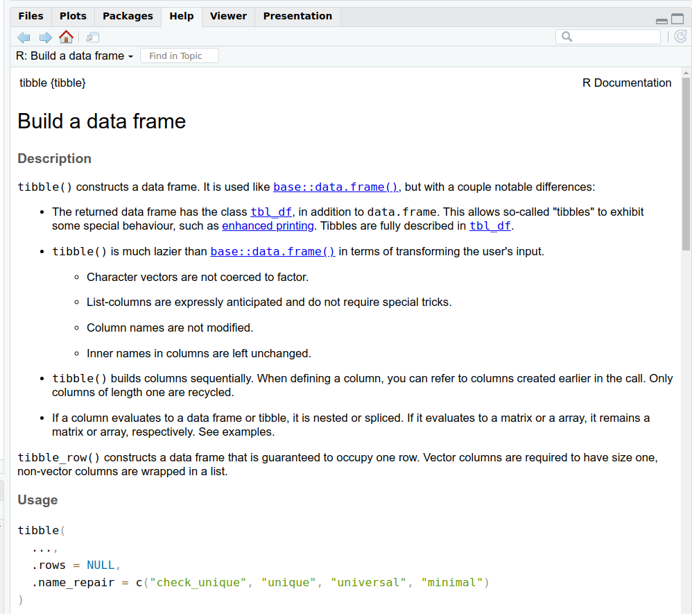

```{r, echo = F, message = F}
library(tidyverse)             # Load after installing
```

## What is the `tidyverse`?

The `tidyverse` is an R package that makes working with data easier than in 'base R', especially for life scientists:

-   **Import** your lab or field data quickly (e.g. `read_csv()` brings in spreadsheets).
-   **Clean and organise** data with simple commands so your tables look exactly how you need them.
-   **Summarise** measurements by groups (e.g. calculate mean height per treatment).
-   **Reshape** data between "wide" and "long" formats for different analyses. (More on this later...)
-   **Plot** effectively with `ggplot2` for dissertation or publication-ready figures.

## Introducing the tidyverse

The `tidyverse` is a collection of R packages designed to work together. Examples include:

-   `dplyr` for data manipulation (`filter()`, `mutate()`, `summarise()`).
-   `readr` for reading files.
-   `tidyr` for reshaping data.
-   `ggplot2` for plotting.

You can install and load `tidyverse` with these functions.

``` r
install.packages("tidyverse")  # Install first-time only
library(tidyverse)             # Load after installing
```

Throughout this course, you will start every script that you make by loading `tidyverse` with `library(tidyverse)`.

## Common `tidyverse` functions

Let's look at some of the common functions in tidyverse

-   `tibble()`: creates a 'data frame', an object with columns and rows, similar to an Excel file
-   `filter()`: keeps rows matching certain conditions
-   `select()`: chooses specific columns from a dataset
-   `mutate()`: creates or transforms columns
-   `group_by()`: defines groups of rows to apply operations within each group
-   `summarise()`: collapses values into summary statistics (often used with `group_by`)
-   `arrange()`: sorts rows in ascending or descending order

``` r
install.packages("tidyverse")  # Install first-time only
library(tidyverse)             # Load after installing
```

## What is a tibble?

-   A **tibble** object is a type of data frame
-   It stores data in rows and columns, like a spreadsheet\
-   Each column has a "type", e.g.
    -   text `<chr>`, numbers `<dbl>`, logical (`TRUE`/`FALSE`) `<lgl>`—more on types later!

```{r, echo = T}
# Example of a tibble containing names, heights, and registration status of students
students_tbl <- tibble(
  name = c("Rosie", "Ben", "Chloe", "Dinesh", "Sara", "Zahraa", "Rana", "Alejandro"),
  height_m = c(1.65, 1.80, 1.72, 1.59, 1.54, 1.70, 1.51, 1.67),
  registered = c(TRUE, FALSE, FALSE, FALSE, FALSE, TRUE, TRUE, TRUE)
)

# Print students_tbl to the screen
students_tbl
```

Note by default, only the first 10 rows are printed to the screen as a preview. <!--
```r
# Same data as a base data.frame
heights_df <- data.frame(
  name = c("Alice", "Ben", "Chloe", "Dinesh"),
  height_m = c(1.65, 1.80, 1.72, 1.59)
)

heights_df
```

Key differences you’ll notice:

- tibbles show column types (`<chr>`, `<dbl>`) under the column names
- tibbles print in a compact format: just the first 10 rows and all columns that fit on screen
- Data frames print everything by default, which can flood your console
- tibbles don’t change column names (e.g. spaces stay as spaces), while data frames may alter them automatically
-->

## Revisiting the pipe: `%>%` or `|>`

Recall that:

-   The pipe `%>%` or `|>` lets you chain operations in a left-to-right flow.
-   The pipe 'sends' objects or function outputs to other functions.
-   `%>%` used to be available only through one of the packages of the `tidyverse` (`dplyr`), but recently base R has added `|>`. These are (currently) interchangable.

The pipe is especially useful in `tidyverse` workflows.

``` r
# Without pipe; confusing and hard to read.
result <- summarise(group_by(data, group), mean_height = mean(height))

# With pipe: read each function line-by-line, much clearer to read
result <- data %>%
  group_by(group) %>%
  summarise(mean_height = mean(height))

# Equivalently with the native pipe in R 4.1+
result <- data |>
  group_by(group) |>
  summarise(mean_height = mean(height))
```

## Using the pipe is the tidy way

::::: columns
::: {.column width="50%"}
Let's revisit our heights example from the last section to see how the pipe is used in a `tidyverse` workflow.

```{r, echo = T, message = F, warning = F}
# Load the tidyverse package
library(tidyverse)

# Sample heights of students in meters (m)
height_m <- c(
  1.56, 1.63, 1.81, 1.69, 1.77,
  1.73, 1.59, 1.73, 1.65, 1.63,
  1.68, 1.50, 1.80, 1.60, 1.78,
  1.68, 1.84, 1.60, 1.64, 1.71,
  1.43, 1.76, 1.84, 1.79, 1.75,
  1.65, 1.81, 1.78, 1.72, 1.68
)

# Now create a tibble with heights as a column
heights <- tibble(height_m)

# Compute mean and standard deviation of height
heights_summary <- heights |>
  summarise(
    mean_height = mean(height_m),
    sd_height   = sd(height_m)
  )
```

The pipe helps with reading code because each line does one function.
:::

::: {.column .fragment width="50%"}
Here is how you would create a plot using `ggplot2` from `tidyverse`. This will look a bit complicated for now, but we'll come back to plotting in a later session.

```{r, echo = T}
# Plot distribution using tidyverse
# 'Send' the heights tibble to ggplot()
histogram_fancy <- heights |>
  ggplot(aes(x = height_m)) +
  geom_histogram()

# Show the histogram on the screen
histogram_fancy # or print(histogram_fancy)
```
:::
:::::

## Getting help

-   As before, Google and ChatGPT are good for working out error messages and other problems.

-   The Cheatsheets at <https://www.rstudio.com/resources/cheatsheets/> are very handy.

-   Use `?` to access the built-in help file.

    

## Next steps

You’ve now set up R, learned the basic grammar of objects and functions, and run your first tidyverse commands. Make sure you complete the "Check your understanding" quiz at the end of the notes page.

In the next session, we’ll look at how to import and 'wrangle' data, explore **summary statistics** of data further, data visualisation and transformation.

You are now ready to attend the first hands-on practical. 


::: {.content-visible when-format="html" unless-format="revealjs"}

## ❓Check your understanding

1. **Tibbles**  
   What does this code create?  
   ```r
   animals <- tibble(
     species = c("Frog", "Beetle", "Bird"),
     count   = c(12, 30, 9)
   )
   ```

   ::: {.callout collapse="true"}
   ## Answer
   A tibble (a modern data frame) with two columns: `species` and `count`.
   :::

2. **Filter**  
   If `animals` is the tibble above, what does  
   ```r
   filter(animals, count > 10)
   ```  
   return?

   ::: {.callout collapse="true"}
   ## Answer
   A tibble with the rows for Frog (12) and Beetle (30), since their counts are greater than 10.
   :::

3. **Mutate**  
   Add a column converting counts to proportions.  
   How would you do this?

   ::: {.callout collapse="true"}
   ## Answer
   ```r
   animals |> 
     mutate(prop = count / sum(count))
   ```
   :::

4. **Group and summarise**  
   Suppose you have a tibble of plant heights with a column `treatment`.  
   How would you calculate the mean height per treatment?

   ::: {.callout collapse="true"}
   ## Answer
   ```r
   plants |>
     group_by(treatment) |>
     summarise(mean_height = mean(height_m))
   ```
   :::

5. **Pipes**  
   Rewrite the following without the pipe:  
   ```r
   animals |> summarise(total = sum(count))
   ```

   ::: {.callout collapse="true"}
   ## Answer
   ```r
   summarise(animals, total = sum(count))
   ```
   :::

:::