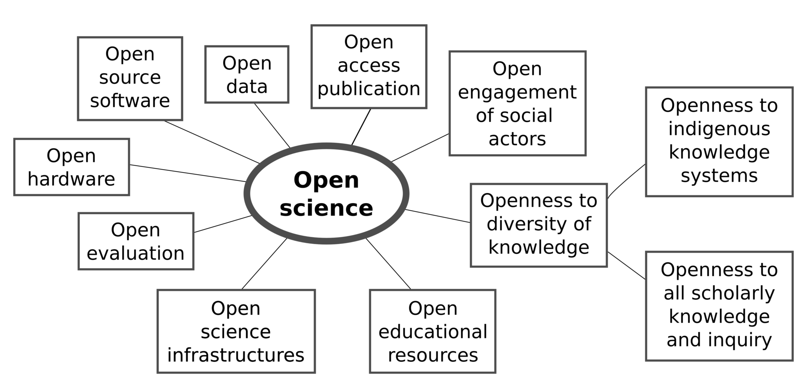
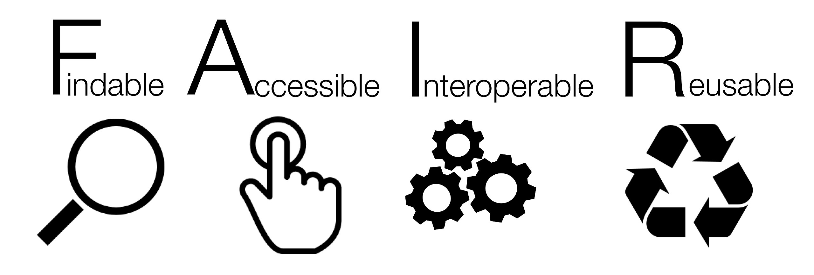
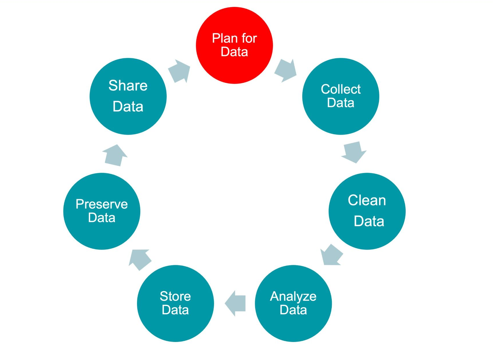

# What is Open Science?

## Introduction

Science is built on transparency, and reproducibility. Yet for much of its history, data and methods were locked away in lab notebooks or hidden behind paywalls. **Open science** asks: what if we did things differently? What if we shared data, code, and results as widely as possible?

In the last decade, open science has grown from a niche idea to a global movement. This lecture explores *why open science matters* and how it’s reshaping the way we do research.

## A motivating story: COVID-19

-   **January 2020:** The genome sequence of the novel coronavirus (SARS-CoV-2) was rapidly posted on an open database (GISAID).
-   **Within days:** Labs worldwide began developing PCR diagnostic tests based on that sequence.
-   **Within weeks:** Multiple vaccine development programmes were underway.

This rapid sharing of data enabled the fastest vaccine development in history. Without open science, the timeline could have been years longer.

## What is open science?

Open science is an umbrella term covering practices that make research more accessible and reusable:

:::::: columns
::: {.column width="\"50%"}

:::

:::: {.column width="\"50%"}
::: incremental
-   **Open access** – making scientific publications freely available.
-   **Open peer review** – making the peer review process and reviewer comments transparent.
-   **Open data** – sharing raw and processed research data for others to inspect and reuse.
-   **Open code** – publishing analysis code, software, or pipelines under open licences.
-   **Open participation** – truly open science invites participation from others.
:::
::::
::::::

## Let's be FAIR about it

These practices align with the FAIR principles: **Findable**, **Accessible**, **Interoperable**, **Reusable**.

::: incremental
-   **Findable:** Data and metadata should have a persistent identifier, be rich in metadata, and be registered in a searchable resource. 
-   **Accessible:** Data should be retrievable by their identifier, and the necessary protocols for access should be open, free, and universally implementable. Metadata should remain accessible even if the data itself is no longer available. 
-   **Interoperable:** Data should use formal, shared, and broadly applicable languages for knowledge representation. Metadata should also include qualified references to other data. 
-   **Reusable:** (Meta)data should be richly described with accurate and relevant attributes to enable reuse. 
:::

## Why do open science? three perspectives

Open science benefits different stakeholders in different ways:

:::::: {.content-visible .incremental when-format="revealjs"}
::: {.fragment .fade-in-then-semi-out}
**1. The scientific community:**\
Reduces duplication of effort, increases reproducibility, fosters new collaborations.

**Example:** The *Human Genome Project* (1990–2003) released human DNA sequences freely online. Helped launch new industries in genomics and biotechnology, as researchers everywhere could access.
:::

::: {.fragment .fade-in-then-semi-out}
**2. Society at large:**\
Public access to publicly-funded research, removes 'paywalls', builds public trust.

**Example:** West African *Ebola outbreak* (2014–2016), rapid sharing of viral genomes facilitated epidemiology and health authorities respond quickly.
:::

::: {.fragment .fade-in-then-semi-out}
**3. You as a researcher:**\
Increases visibility and impact, establish priority on findings, demonstrates credibility.

**Example:** The R package *ggplot2* (Hadley Wickham, 2007) is now used by tens of thousands of papers.
:::
::::::

:::::: {.content-visible when-format="html" unless-format="revealjs"}
::: {.callout collapse="true"}
### 1. For the scientific community

-   Prevents duplication of effort: one group’s dataset can be another’s starting point.
-   Enables reproducibility and trust in results by allowing others to verify findings.
-   Sparks unexpected collaborations across labs and disciplines.

**Example:** The *Human Genome Project* (1990–2003) released human DNA sequences freely online as they were decoded. This openness helped launch new industries in genomics and biotechnology, as researchers everywhere could access and build on the data immediately.
:::

::: {.callout collapse="true"}
### 2. For society

-   Much of science is publicly funded; open outputs ensure the public can access what they’ve paid for.
-   Open access breaks down paywalls, empowering clinicians, teachers, and policymakers who often lack subscriptions.
-   Transparency in science enhances public trust.

**Example:** During the West African *Ebola outbreak* (2014–2016), scientists rapidly shared viral genome sequences and analyses as preprints. This enabled field epidemiologists and health authorities to track the virus’s evolution in real time and adapt response strategies immediately.
:::

::: {.callout collapse="true"}
### 3. For you as a researcher

-   Increases the visibility and impact of your work (open papers and data tend to receive more citations).
-   Posting of preprints lets you establish priority for discoveries without waiting months for formal publication and early dissemination of results.
-   Sharing code and data demonstrates credibility, making you a more trustworthy collaborator and broadening your network.

**Example:** The R package *ggplot2* (Hadley Wickham, 2007) was released as open‑source software. It is now one of the most widely used data visualisation tools in science, credited in thousands of papers — openness helped it spread and be cited.
:::
::::::

## The risks of closed science

-   **Data locked away** (the “file drawer”) → wasted resources and missed opportunities.
-   **Paywalled findings** → researchers in low‑resource settings or smaller institutions get left behind.
-   **Lack of transparency** → fosters irreproducibility or even misconduct if no one can check the data or methods.

**Case in point:** In 2020, a company called *Surgisphere* claimed to hold vast COVID‑19 clinical datasets. Based on their private data, major studies on COVID treatments were published in *The Lancet* and *NEJM*. When no one could independently verify the data, the studies were retracted. The scandal undermined public trust at a critical moment. Open principles (data sharing, transparent review) could have flagged problems earlier.

:::::: {.content-visible when-format="html" unless-format="revealjs"}

## Building an open science culture

There are many key aspects to building an open science culture

::: incremental
-   **Use data repositories:** Deposit datasets in open repositories like Zenodo, Dryad, or Figshare (which provide DOIs for citation).
-   **Post preprints:** Post draft manuscripts on preprint serfvers (e.g. bioRxiv) to get early feedback and disseminate results quickly.
-   **Make open source code:** Share analysis code on GitHub or GitLab with clear licensing (e.g. GPL, MIT), and include documentation for reuse.
-   **Publish in open access journals:** Choose journals or platforms that make your paper freely accessible, or deposit accepted manuscripts in institutional repositories.
-   **Explicitly state projects are open to collaboration:** Difficult in practice in biology, but examples exist (e.g. AllTheBacteria).
-   **Community engagement:** Contribute to open research tools, e.g. sharing a protocol on a blog or protocol site, posting bug reports on software tool pages.
:::
::::

------------------------------------------------------------------------

# How to do open science

## Before starting a project

Good open science begins with a plan.\
Before collecting any data, researchers can **preregister** their ideas — writing down what questions they will ask and how they will test them.\
This helps show which results were predicted in advance, and which were discovered along the way.

It’s also important to make a **data plan**: decide how data will be collected, stored safely, and shared later.\
Planning early makes it easier to keep the project organised and trustworthy.

## During the project

While the research is happening, the key is **good record-keeping and transparency**.\
Scientists keep lab books (on paper or online) so that every step can be traced.\
They often use **open tools**, like R or Python, so that others can see exactly how results were analysed.

By carefully recording methods and sharing clear protocols, researchers make it possible for others to repeat and check their work — the heart of reproducibility.

## After the project

When the research is finished, open science means making the outputs available to everyone.\
Data can be uploaded to public repositories (like Zenodo or Dryad).\
Code can be shared on platforms like GitHub.\
And results can be posted as **preprints** or in **open-access journals**, so anyone can read them without paywalls.

This final step ensures that the knowledge created is not locked away, but can be built on by other scientists—and by society.  

As students who will be doing research projects, it's also important that **your supervisors** have your data in a usable format, as they might use your project as the basis for a grant application or as part of publication—which benefits you, too.

------------------------------------------------------------------------

## A vision for the future

Imagine a scientific world where:

-   **Any dataset** you need is one click away, well‑documented and reusable.
-   **Methods** are transparent, and workflows are shared so experiments can be replicated.
-   **Publications** and results are immediately available to anyone, anywhere in the world.

This is the vision of open science. It requires a cultural shift toward collaboration, equity, and accelerated discovery.

## Key takeaways

-   Open science **accelerates discovery** (e.g., rapid COVID‑19 vaccine development enabled by open data sharing).
-   Open practices **ensure transparency and reproducibility** (e.g., open genome data; widely shared tools like ggplot2).
-   Closed science **slows progress and erodes trust** (e.g., the Surgisphere affair).
-   As early‑career researchers, you can shape the culture. Embracing openness helps drive science forward for everyone.
