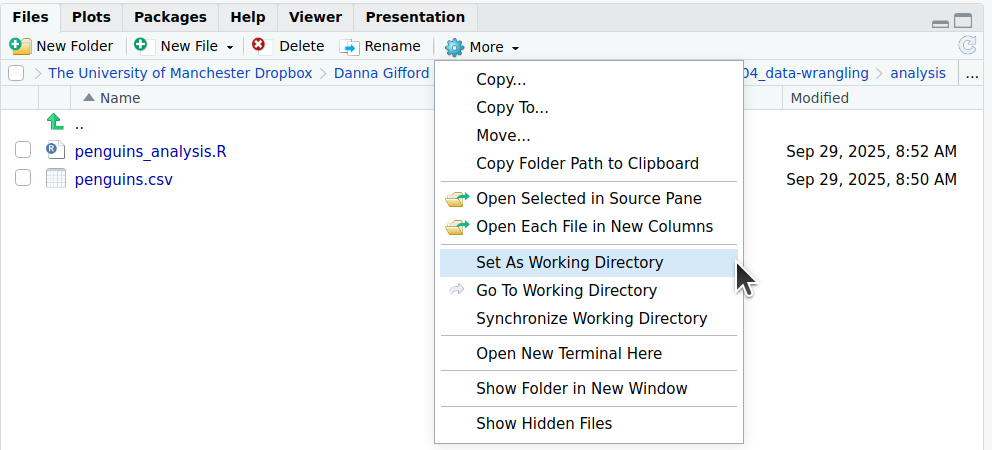
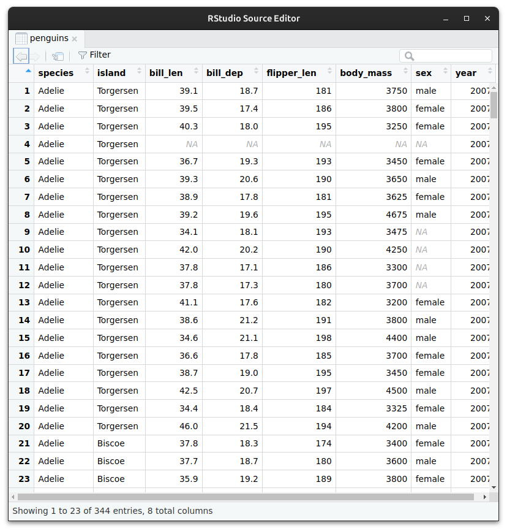
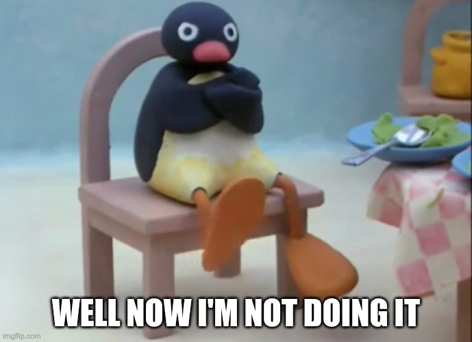

```{r, echo=F, message=F, warning=F}
library(tidyverse)
library(palmerpenguins)
```

::: {.content-visible when-format="html" unless-format="revealjs"}
<iframe src="https://video.manchester.ac.uk/embedded/ffffffff-94ec-7b5d-0000-0199c457ea40" width="660" height="380" style="border:none; overflow: hidden;" scrolling="no"  webkitallowfullscreen mozallowfullscreen allowfullscreen></iframe>
:::

# Data wrangling

::: {.notes}
Welcome to our session on data wrangling.
This week we’ll look at how we take raw biological data and turn it into something we can actually analyse.
Real datasets are rarely perfect — they come with missing values, messy names, or too many columns.
Our job is to wrangle them into a clean, tidy form that R can work with.
:::

## What is data wrangling?

When we collect biological data, it never arrives perfectly polished. Files might have missing values, inconsistent names, or more information than we really need.\

Before we can analyse or visualise, we first have to *wrangle* our data into a form that both we, and R, can understand. Part of this also involves checking if there are any problems with the data (like missing values), or anything unexpected that might be confusing (like columns with unintuitive names).\

The word *wrangle* can mean either "to have an argument that continues for a long time" (chiefly UK), or "to take care of, control, or move large animals, often with difficulty or coercion" (chiefly North American). In dealing with biological data, either definition can sometimes feel appropriate!

, CC [BY-NC-SA 2.0](https://creativecommons.org/licenses/by-nc-sa/2.0/)](images/king-penguin-colony.jpg){fig-alt="A colony of thousands of King Penguins. The colony fills the entire image, showing no ground or sky. The intent is to evoke a chaotic disorganised scene in need of 'wrangling'."}

::: {.notes}
When we talk about wrangling, we mean cleaning, reshaping, and preparing data.
It’s the step between collecting your data and analysing it.
Sometimes it feels like arguing endlessly with your data, and other times like herding stubborn animals — both meanings of “wrangle” are pretty accurate!
But once the data are tamed, everything that follows becomes easier.
:::

------------------------------------------------------------------------

## Remember tibbles?

In the first session, we made some **tibbles by hand** to see how R stores data.\
A tibble is just a table where:

-   Each **column** is a variable (e.g. species, sepal length)\
-   Each **row** is an observation (e.g. one plant)\
-   Each **cell** is a single value (i.e. the measurement of that variable for that individual)

Example from last time:

``` r
library(tidyverse)

plants <- tibble(
  treatment = c("control", "fertilised", "control"),
  height_cm = c(15, 20, 13),
  survival = c(TRUE, TRUE, FALSE)
)

plants
```

Now, it would be a colossal waste of time if we had to write out each tibble manually!\
Typically in R, we read in data from files on our computer or from the internet.

::: {.notes}
You might remember that in R we store data in tibbles — tidy little tables.
Each column is a variable, each row is an observation, and each cell holds one value.
For example, one column could be “species”, another “flipper length”, and each row would be a single penguin.
Writing these by hand would be ridiculous — so we normally import data from files instead of typing them out manually.
:::

## Telling R where to look for data

:::::::: {columns}
:::::: {.column width="50%"}
::: incremental
-   Every time R looks for a file, it needs to know *where to look*.\
-   The simplest way to do this is to set your **working directory**, and keep your `.R` scripts and data files together in the same place
-   Imagine your computer as a giant house 🏡. The working directory is the room you’re currently in. R will look for files within that room. If the file is in another room, R won’t find it unless you give the full address.
:::

:::: fragment
You can check or set the working directory with `getwd()` and `setwd()`:

``` r
getwd()                 # shows where you are now
setwd("path/to/folder") # moves R to another room
```

::: {.content-visible when-format="html" unless-format="revealjs"}
💡 How you specify your working directory, and 'paths' to files more generally, will depend on what operating system you are using

``` r
# Set working directory, e.g.:
setwd("C:/Documents/04_data-wrangling/analysis") # Windows
setwd("/Users/danna/04_data-wrangling/analysis") # Mac
setwd("/home/danna/04_data-wrangling/analysis")  # Linux
```
:::
::::
::::::

::: {.column .fragment width="50%"}
You can also set the working directory using the menu:\
"Session \> Set Working Directory \> Choose Directory..."

Or, you can use the Files tab on the right:

{fig-alt="A screenshot of how to set the working directory from the files tab."}
:::
::::::::

::: {.notes}
Before we can import data, R needs to know where the file lives.
That’s what the working directory is.
Imagine your computer as a big house and R as standing in one room — that room is your working directory.
If your data are in another room, R can’t see them unless you give it the full address.
You can check where you are with getwd() and move rooms with setwd(), or just use the Files tab or Session menu in RStudio.
:::
------------------------------------------------------------------------

## Palmer penguins dataset 🐧

::::: columns
::: {.column width="50%"}
Let's have a look at some common data wrangling steps using real data.

The `palmerpenguins` dataset[^1] contains size measurements for 3 penguin species observed between 2007‒2009 in the Palmer Archipelago, Antarctica, by Dr. Kristen Gorman with the [Palmer Station Long Term Ecological Research Program](https://pal.lternet.edu/).

If you're following along in R, please download [`penguins.csv`](../../data/penguins.csv) and save it to your working directory.
:::

::: {.column width="50%"}
![Sampling context: (a) Antarctica. (b) Antarctic peninsula. (c) Islands where penguins were sampled: Dream, Torgersen, and Biscoe.[^2]](images/antarctica.png)
:::
:::::

[^1]: **Horst AM, Hill AP, Gorman KB** (2020). `palmerpenguins`: Palmer Archipelago (Antarctica) penguin data. R package version 0.1.0. [https://allisonhorst.github.io/palmerpenguins/](#0). Data are available by [CC-0](https://creativecommons.org/share-your-work/public-domain/cc0/) license in accordance with the [Palmer Station LTER Data Policy](https://pallter.marine.rutgers.edu/data/) and the [LTER Data Access Policy for Type I data](https://lternet.edu/data-access-policy/), part of the [US Long Term Ecological Research Network](https://lternet.edu/).

[^2]: Original publication: **Gorman KB, Williams TD, Fraser WR** (2014). Ecological sexual dimorphism and environmental variability within a community of Antarctic penguins (genus *Pygoscelis*). *PLoS ONE* 9(3):e90081. <https://doi.org/10.1371/journal.pone.0090081>.

[^3]: Original publication: **Gorman KB, Williams TD, Fraser WR** (2014). Ecological sexual dimorphism and environmental variability within a community of Antarctic penguins (genus *Pygoscelis*). *PLoS ONE* 9(3):e90081. <https://doi.org/10.1371/journal.pone.0090081>.

::: {.notes}
To practise, we’ll use the Palmer Penguins dataset.
It contains measurements from three species of penguins collected in the Palmer Archipelago, Antarctica, between 2007 and 2009 by Kristen Gorman and colleagues.
If you’re following along, download the file penguins.csv and save it in your working directory.
It’s a perfect example of tidy, real biological data.
:::

## Importing data

Most of the time, our data will be stored in **CSV files** (comma-separated values).\
These are simple text files that can be read by almost any program.

In the tidyverse, we use `read_csv()`[^4]:

[^4]: NB: It is important that you use `read_csv()` throughout the unit. Base R uses `read.csv()`, which imports data in a slightly different way.

::: {style="font-size: 85%;"}
``` r
library(tidyverse)

# First set working directory to where your file is saved. It looks slightly different on different systems:
setwd("C:/Documents/04_data-wrangling/analysis") # Windows
setwd("/Users/danna/04_data-wrangling/analysis") # Mac
setwd("/home/danna/04_data-wrangling/analysis")  # Linux

# Loading the data using read_csv():
# From a file saved on your computer in your working directory
penguins <- read_csv("penguins.csv")

# From a folder called 'data' within your working directory (a 'relative path')
penguins <- read_csv("data/penguins.csv")

# From a file saved somewhere else on your computer (an 'absolute path')
penguins <- read_csv("C:/Documents/data/penguins.csv")              # Windows
penguins <- read_csv("/home/username/Documents/data/penguins.csv")  # Mac
penguins <- read_csv("/Users/username/Documents/data/penguins.csv") # Linux

# Directly from a URL
penguins <- read_csv("https://raw.githubusercontent.com/allisonhorst/palmerpenguins/master/inst/extdata/penguins.csv")
```
:::

```{=html}
<!--
You might find small hurdles at this stage:

-   If R says the file is not found, check your working directory with `getwd()`.\
-   If your working directory is correct, use your operating system to navigate to where that file should be, and check that it is there.
-   If the file uses tabs instead of commas, try `read_tsv()`.\
-   If the file has no headers, you can add `col_names = FALSE`.
-->
```

::: {.notes}
Most datasets come as CSV files — comma-separated values.
They’re plain text and easy to open in almost any software.
In the tidyverse we use read_csv() to import them.
You can read a file from your computer, from a “data” folder, or even directly from a URL.
Whichever method you use, read_csv() gives you a tibble containing your data, ready to explore.
:::

------------------------------------------------------------------------

## Meeting the tibble

::::: columns
::: {.column width="70%"}
When you use `read_csv()`, R gives you a tibble, just like the ones we wrote by hand.

```{r, echo = F, message = F, warning = F}
penguins <- as_tibble(penguins)
```

Typing in the name of the tibble and pressing Ctrl+Enter (Windows/Linux) or Cmd+Enter (Mac) will print the first 10 rows to the Console window:

```{r, echo = T}
penguins
```
:::

::: {.column width="30%"}
.](images/2007_Snow-Hill-Island-Adelie-Penguins.jpg)
:::
:::::

::: {.notes}
After you import, just type the name of the tibble to see the first few rows.
You should see columns for species, island, bill length, bill depth, flipper length, body mass, sex, and year — one row per penguin.
This quick peek confirms the data loaded properly.
It’s also a good habit to always look at your data before doing anything else.
:::

## Looking at the data

Once you have loaded your data, you should check to see if it looks the way you think it should.\
There are a few quick ways to peek. You should type these into the Console window.

::: fragment
```{r, echo = T}
head(penguins)      # shows the first few rows
```

| 
| 
:::

::: fragment
```{r, echo = T}
glimpse(penguins)   # a sideways summary of all columns
```

| 
| 
:::

::: fragment
``` r
View(penguins)   # a spreadsheet-style viewer (but you cannot edit values).
```
:::

::: {.content-visible when-format="html" unless-format="revealjs"}
 You can also click the object's name in the Environment window.
:::

::: {.notes}
🟦 Looking at the data

There are a few handy ways to inspect it.
head() shows the first few rows.
glimpse() gives a sideways summary of all the columns and their data types.
And View() opens a spreadsheet-style viewer in RStudio — useful for spotting issues, though you can’t edit values there.
Always take a moment to check that the data look as expected.
:::

## Data types

In the `head()` and `glimpse()` output above, you'll notice that each column has a designation `<abc>` either below or beside it. These correspond to the "type" of data each column contains. The main data types you will encounter are listed below:

-   `<chr>` means `character`, which is text or a mixture of text, numbers & punctuation.\
-   `<fct>` means `factor`, a special type of text where the levels are pre-defined (e.g. sex).\
-   `<dbl>` means numbers with decimals, `double`, a type of `numeric`.\
-   `<int>` means whole numbers, `integer`, another type of `numeric`.\
-   `<lgl>` means `logical`, TRUE/FALSE values (not shown here).\
-   `<date>` means calendar dates (also not shown here).

This is different from Excel. You should only put data of the same type together in a single column. If you mix data types, it will default to character.

::: {.notes}
In the output from head() or glimpse(), you’ll see labels like <chr>, <dbl>, or <fct>.
These are the data types:
<chr> for character, or text
<fct> for factor, used for categories like “male” or “female”
<dbl> for numbers with decimals
<int> for whole numbers
<lgl> for logical, TRUE or FALSE
R behaves differently depending on these types, so make sure each column has the right one.
:::

:::: {.content-visible when-format="html" unless-format="revealjs"}
::: {.callout collapse="true"}
## What is a "double"? How R and other programming languages represent numbers

You don't need to know this, but you might be wondering why R calls decimal numbers "doubles", `<dbl>`.

In R there are basically two main `numeric` types:

-   Integers: whole numbers (e.g. 5, -12)
-   Doubles: decimal numbers (e.g. 5.0, -9.13, 3.14159).

"Double" in this context means [double-precision floating-point format](https://en.wikipedia.org/wiki/Double-precision_floating-point_format): a format that gives high accuracy (lots of decimal places) and can handle very big or very small values, but take up more memory than less precise formats.

Computers today manage doubles easily, so R uses them by default. [Singles](https://en.wikipedia.org/wiki/Single-precision_floating-point_format) (less precise decimals) aren’t used in R, but the term double is still used for consistency.

Whole numbers can—and ideally should—be stored as [integers](https://en.wikipedia.org/wiki/Integer_(computer_science)) (`<int>`). One reason for this is that doubles and singles can't exactly represent integers, they can only approximate them.

But there's also real biological distinction between data recorded as integers and decimals, particularly when it comes to counting—you can't have 5.73 penguins, for instance (well, not living ones, at least).

This distinction can be meaningful when you apply different statistical tests, as some tests are more appropriate for decimal numbers, and others for e.g. counts. We'll come to this distinction in the session on generalised linear modelling.
:::
::::

------------------------------------------------------------------------

# Tidy data
::: {.notes}
Now that we know what our data look like, let’s talk about tidy data.
:::

## What is tidy data?

A huge amount of effort in analysis goes into *cleaning* data so that it’s usable. **Tidy data** gives us a simple, consistent structure that makes analysis, modelling, and visualisation easier.

::::: columns
::: {.column width="35%"}
In tidy data:

-   Each **variable** forms a **column**\
-   Each **observation** forms a **row**\
-   Each **value** is a cell.
:::

::: {.column width="65%"}
Our `penguins` dataset is already tidy:

```{r}
penguins |> select(-c(body_mass_g, flipper_length_mm))
```
:::
:::::

This also ensures different variables measured on the same observation always stay together.

::: {.notes}
Tidy data have a simple structure: each variable in its own column, each observation in its own row, and each value in its own cell.
Our penguins data already follow this tidy format, which is why they’re so pleasant to work with.
Tidy data make analysis, modelling, and plotting consistent across the tidyverse.
:::

## Tidying 'untidy' data

Untidy data are arranged in any other way, e.g, when column names are actually values, or when several variables are crammed into one column. Here's some untidy data on Weddell seals, which also live in Antarctica.

Each column represents a combination of *variable* and *year*, so the dataset is **not tidy** — the years are stored as column headers.

```{r, echo = T}
#| output-location: column
weddell <- tibble(
  seal_id = c("W01", "W02", "W03", "W04", "W05"),
  length_2022 = c(260, 250, 270, 255, 265),
  weight_2022 = c(420, 390, 450, 410, 430),
  length_2023 = c(265, 253, 275, 260, 270),
  weight_2023 = c(430, 400, 460, 420, 440)
)

weddell
```

This layout hides the meaning of the data:

-   `Year` is buried in the column names
-   Each row mixes multiple observations (2022 and 2023) for the same seal

::: {.notes}
But not all datasets you'll come across are in tidy form.
Let's look at example. Here's some untidy data on Weddell seals, which also live in Antarctica. This dataset is untidy because the variable 'year' is embedded in the column name.
Also, each row contains multiple observations for the same seal.
This kind of layout is awkward to analyse because the meaning is hidden in the structure.
:::

## Making it tidy

We can tidy the seal data by turning those year-specific columns into variables for **year**, **length**, and **weight**.

```{r, echo = T}
#| output-location: column
weddell_tidy <- weddell |>
  pivot_longer(
    cols = starts_with(c("length", "weight")),
    names_to = c(".value", "year"),
    names_sep = "_"
  )
weddell_tidy
```
Now each row is a single observation: one seal, in one year, with one set of measurements

](images/Face_of_Weddell_Seal.jpg){fig-align="left" fig-height=3in}

::: {.notes}
We can fix that using pivot_longer().
It takes those year-specific columns and turns them into proper variables: one for year, one for length, and one for weight.
Now each row represents one seal, in one year, with one set of measurements.
That’s the tidy structure we want, and it makes future analyses much easier.
:::

## Cleaning and preparing for analysis

::::{columns}
:::{.column width="70%" .fragment}
Let’s return to our `penguins` data.

```{r}
penguins
```

The dataset is already *tidy*, but that doesn’t mean it’s completely *clean*. Real datasets often have:

-   messy or inconsistent column names,\
-   extra variables we don’t need,
-   values that need to be converted or fixed, or
-   missing values.
:::

:::{.column width="30%" .fragment}
We often need to **clean and prepare** imported data before analysis. You can:

- `rename()` columns to make them clearer\
- `select()` only the variables you need\
- `filter()` rows to focus on certain observations\
- `mutate()` to create new variables\
- `arrange()` to sort your data
:::
::::


::: {.notes}
Let’s return to the penguins.
The dataset is tidy, but that doesn’t mean it’s clean.
Real data almost always have quirks — inconsistent column names, unnecessary variables, or missing values.
We can clean them up using a handful of tidyverse functions.
:::

::: {.content-visible when-format="revealjs"}
## Cleaning and preparing for analysis
:::

Here are some examples of cleaning steps

::: {.fragment}
Rename columns to help understanding:

``` r
penguins <- penguins |> rename(bill_length_mm = bill_len,
                   bill_depth_mm = bill_dep) # new_name = old_name
```
:::
::: {.fragment}
Select only the columns you need for your analysis:

``` r
# Sometimes we only need a few columns:
penguins <- penguins |> select(species, island, body_mass)
```
:::
::: {.fragment}
Subset the data, e.g. to focus on a single species:

``` r
# Sometimes we want to focus on just one subset, a single species:
penguins <- penguins |> filter(species == "Adelie")
```
:::
::: {.fragment}
Create a new column from existing data:

``` r
penguins <- penguins |> mutate(weight_kg = body_mass_g / 1000)
```
:::
::: {.fragment}
Rearrange the order of the table according to one or more columns:

``` r
penguins <- penguins |> arrange(bill_length_mm)
```
:::

::: {.notes}
The main tools are:
rename() to change column names,
select() to choose columns,
filter() to pick rows,
mutate() to create or transform variables,
and arrange() to sort the data.
For example, we could rename “bill_len” to “bill_length_mm”, select only species and body mass, filter for Adelie penguins, add a new column converting grams to kilograms, and finally arrange by bill length.
:::

## Dealing with missing values

Sometimes datasets have 'holes': a penguin might have been captured but not weighed, for instance. Let's look at the first ten penguin body mass measurements of our penguins:

```{r, echo = T}
#| output-location: column
penguins$body_mass_g[1:10]
```

::: fragment
The special value `NA` is how R identifies missing data. What happens if you try to take the mean?

```{r, echo = T}
#| output-location: column
mean(penguins$body_mass_g)
```
:::

::: fragment
One solution for some functions is to tell R to ignore `NA` values in its calculations:

```{r, echo = T}
#| output-location: column
mean(penguins$body_mass_g, na.rm = TRUE) 
```
:::

:::::: fragment
::::: columns
::: {.column width="70%"}
However, for some functions, ignoring `NA` is not possible and R will return an error message.

::: fragment
Sometimes it's appropriate to remove entries missing values from the dataset entirely

``` r
# Returns TRUE for cells where sex is unknown
is.na(penguins$sex)

# Keeps rows where sex *is* known:
penguins_clean <- penguins |> filter(!is.na(sex))

# Removes rows with missing data in *any* column:
penguins_clean <- penguins |> remove_missing()   
```
:::

:::

::: {.column width="30%"}
{fig-alt="A picture of the claymation character Pingu with an obstinate expression, captioned with the text \"Well now I'm not doing it\"" fig-align="center"}
:::
:::::
::::::


::: {.notes}
Many biological datasets have missing values — maybe a penguin wasn’t weighed, or the data weren’t recorded.
In R, missing data are shown as NA.
If you try to calculate a mean and the column includes NAs, R will return NA because it doesn’t know what to do.
You can tell it to ignore missing values with na.rm = TRUE.
Or, if you prefer, you can remove those rows entirely using filter(!is.na(variable)) or remove_missing().
Be deliberate: sometimes it’s fine to ignore missing data, other times it changes your results.
:::

## Chaining steps with pipes

Often, we want to do several of these actions in a row.\
The pipe operator `|>` lets us pass the result of one step straight into the next:

``` r
penguins |>
  remove_missing() |>
  filter(species == "Gentoo") |>
  mutate(weight_kg = body_mass_g / 1000) |>
  select(species, island, weight_kg)
```

Reading this top to bottom is almost like reading a recipe:

-   Start with the whole `penguins` data set\
-   Filter for the species Gentoo\
-   Calculate weight in kg\
-   Select just the columns needed for your analysis

This makes your code readable for both you and anyone else who needs to check it later.

::: {.notes}
When you start combining several cleaning steps, your code can look messy.
The pipe operator, |>, helps keep it readable.
It passes the output of one step directly into the next — almost like saying “and then.”
For example:
start with penguins, and then remove missing values, and then filter for Gentoo penguins, and then create weight_kg, and finally select the columns you need. This helps keep your workflow clear.
:::

------------------------------------------------------------------------

## Recap & next steps

-   Data wrangling is about preparing data for analysis.\
-   Always inspect what you imported.\
-   Tidyverse functions like `filter`, `mutate`, `select`, `arrange`, `rename` are your everyday tools.\
-   Pipes make your workflow clear and logical.
-   Missing values (`NA`) are common and should be handled.\

You've now learned how to import and tidy real biological datasets. Next, we'll take a look at how to summarise this data using handy functions from the `tidyverse`.

::: {.notes}
To recap, in this session we've covered:
data wrangling, the process of preparing data for analysis.
Inspecting data after importing it.
Tidyverse functions for tidying and cleaning data.
How to use pipes in a tidy workflow
How to handle missing values.

In our next session, we’ll see how to summarise and describe that data using functions from the tidyverse.
See you in the next one!
:::

------------------------------------------------------------------------

::::::::: {.content-visible when-format="html" unless-format="revealjs"}
## ❓Check your understanding

1.  You have a file called `plants.csv` in your working directory.\
    Write the line of code that would import it as a tibble.

::: {.callout collapse="true"}
## Answer

``` r
plants <- read_csv("plants.csv")
```
:::

2.  After importing a dataset, you want to quickly check its structure.\
    Which two functions could you use?

::: {.callout collapse="true"}
## Answer

``` r
glimpse(plants)
head(plants)
```
:::

3.  You try to calculate `sd(height)` but get `NA` as the result.\
    How would you fix this?

::: {.callout collapse="true"}
## Answer

``` r
sd(height, na.rm = T)
```
:::

4.  Write code to filter the `penguins` tibble for rows where the island is `"Dream"`.

::: {.callout collapse="true"}
## Answer

``` r
penguins |>
    filter(island == "Dream")
```

If you want to make a new tibble with only the Dream island penguins, don't forget to assign the filtered tibble to a new object

``` r
penguins_dream <- penguins |>
    filter(island == "Dream")
```
:::

5.  Add a new column to `penguins` called `bill_ratio` equal to `bill_length_mm / bill_depth_mm`. Remember, to *add* a column, you need to reassign `penguins`. Otherwise the new column is only printed to the screen.

:::: {.callout collapse="true"}
## Answer

``` r
penguins <- penguins |>
    mutate(bill_ratio = bill_length_mm/bill_depth)
```

::: :::
:::
::::
:::::::::
