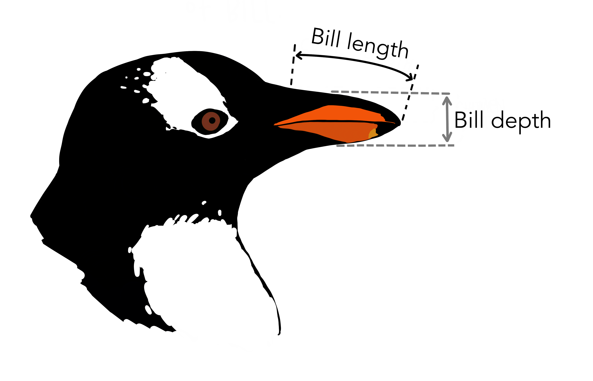

```{r,echo=F, message=F}
library(tidyverse)
library(palmerpenguins)
library(ggthemes) # colourblind and theme_few
theme_set(theme_few(base_size = 16))
```
:::: {.content-visible when-format="html" unless-format="revealjs"}
<iframe src="https://video.manchester.ac.uk/embedded/ffffffff-fbd8-a17a-0000-0199e1ec3de0" width="660" height="380" style="border:none; overflow: hidden;" scrolling="no"  webkitallowfullscreen mozallowfullscreen allowfullscreen></iframe>
:::

## Defining correlation

Correlation tells us **how strongly two continuous variables vary together**.

Examples in biology:

-   Do heavier animals tend to live longer?
-   Do larger cells contain more protein?
-   Does bacterial growth rate increase with temperature?

::: notes
Correlation gives us a way to quantify the degree to which two variables move together — either positively or negatively.\
In biology, we're often interested in whether size, performance, or expression levels are linked.\
This is a descriptive measure — not causal proof.
:::

## Interpreting patterns

-   Positive correlation: as one variable increases, so does the other.\
-   Negative correlation: as one increases, the other decreases.\
-   No correlation: no consistent trend.

```{r, message=F}
# Quick examples with r labels
library(tidyverse)

set.seed(19)
x <- 1:10
y_pos <- x + rnorm(10)
y_neg <- 10 - x + rnorm(10)
y_none <- rnorm(10)

# Combine into tibble
df <- tibble(
  x = rep(x, 3),
  y = c(y_pos, y_neg, y_none),
  type = rep(c("Positive", "Negative", "None"), each = 10)
)

# Compute correlation for each type
cors <- df |>
  group_by(type) |>
  summarise(r = cor(x, y)) |>
  mutate(label = paste0("r = ", round(r, 2)))

# Plot with r annotations
ggplot(df, aes(x, y)) +
  geom_point() +
  geom_smooth(method = "lm", se = FALSE, colour = "darkorange") +
  facet_wrap(~type) +
  geom_text(
    data = cors,
    aes(x = -Inf, y = Inf, label = label),
    hjust = -0.1, vjust = 1.5,
    size = 5, colour = "black",
    inherit.aes = FALSE
  )

```

::: notes
These examples illustrate what correlation looks like.\
The line direction tells you whether the relationship is positive or negative.\
A tight clustering around a line means a stronger relationship.
:::

## Quantifying correlation

The **Pearson correlation coefficient (r)** measures **linear** association:

$$
r = \frac{\text{cov}(x, y)}{s_x s_y}
$$

-   $r$ ranges from **−1 to +1**
-   +1: perfect positive linear relationship\
-   −1: perfect negative\
-   0: no linear relationship

## Example using real data

Let's return to our Palmer Penguins. We'll look at whether there's a correlation between bill depth and bill length for Gentoo penguins:

::::: {columns}
::: {.column width="50%"}

:::

::: {.column width="50%"}
```{r, echo=T, output=F}
# Only Gentoo data
Gentoo <- penguins |>
  filter(species == "Gentoo")

cor(x = Gentoo$bill_length_mm,
    y = Gentoo$bill_depth_mm,
    use = "complete.obs")
```

The correlation coefficient *r* is 0.64, indicating a positive correlation.
:::
:::::

::: notes
Pearson’s *r* is a normalised measure of covariance, showing how much two variables co-vary relative to their individual variation.\
Values near 0 mean little to no linear relationship.\
We typically use `cor()` in R to compute it.
:::

## Statistical significance for correlations

To test whether the observed *r* could arise by chance, use a **correlation test**.

```{r, echo=T}
#| output-location: column

cor.test(
  x = Gentoo$bill_length_mm, 
  y = Gentoo$bill_depth_mm,
  use = "complete.obs"   # Ignore NAs
)
```

There is a significant correlation between bill length and depth for Gentoo penguins (Pearson correlation: $r=0.64$, $t_{121} = 9.24$, $p=1\times10^{-15}$).

::: notes
`cor.test()` performs a hypothesis test for whether the true correlation is 0.\
The null hypothesis is *no correlation*.\
It returns *r*, a p-value, and a confidence interval.\
Interpret it like other hypothesis tests — p \< 0.05 suggests a significant correlation.
:::

## Assumptions

Pearson’s correlation assumes:

-   Both variables are **continuous**
-   Relationship is **linear**
-   Data are **approximately normally distributed**
-   **No major outliers**

All four of these plots have *r* = 0.816, but show different data:

```{r, message=F, warning=F}
# Convert to tidy format
anscombe_tidy <- anscombe |>
  pivot_longer(
    cols = everything(),
    names_to = c(".value", "set"),
    names_pattern = "(.)(.)"
  )

# Calculate correlations to show they're identical
# anscombe_tidy |>
#   group_by(set) |>
#   summarise(r = cor(x, y))

# Plot the four datasets
ggplot(anscombe_tidy, aes(x, y)) +
  geom_point(size = 3, colour = "steelblue") +
  geom_smooth(method = "lm", se = FALSE, colour = "darkorange", linewidth = 1) +
  facet_wrap(~set)
```

## Comparing across groups

Perhaps we want to know if the strength of the correlation differs between species. We can do this using `group_by(species)` and `summarise()` from the `tidyverse`, just like we did previously for means:

```{r, echo=T}
penguins |> 
  group_by(species) |> 
  summarise(r = cor(x = bill_length_mm, 
                    y = bill_depth_mm,
                    use = "complete.obs")) # Ignore NAs
```

Here, Adélie penguins have the lowest correlation between bill length and depth.

::: notes
Sometimes we’re interested in whether the relationship differs by group — species, treatments, etc.\
By grouping, we can see that correlations can vary in strength and even direction between biological groups.\
Never assume one overall correlation describes your entire dataset.
:::

## Visualising correlations

It's important to check whether it is reasonable to assume linearity

::: {.content-visible when-format="html" unless-format="revealjs"}
```{r, echo=T, message=F,warning=F}
# Compute correlation and centroid for each species
cors <- penguins |>
  group_by(species) |>
  summarise(
    r = cor(bill_length_mm, bill_depth_mm, use = "complete.obs"),
    x = mean(bill_length_mm, na.rm = TRUE),
    y = mean(bill_depth_mm, na.rm = TRUE)
  ) |>
  mutate(label = paste0("italic(r) == ", round(r, 2)))  # to make r italic


linear_check <- penguins |> 
  ggplot(aes(x = bill_length_mm, 
             y = bill_depth_mm, 
             colour = species)) +
  geom_point(size = 3, alpha = 0.8) +
  scale_color_colorblind() +
  geom_smooth(method = "lm", se = FALSE) +
  geom_label(
    data = cors,
    aes(x = x, y = y, label = label, colour = species),
    size  = 5,
    parse = TRUE,       # to interpret `italic()`
    show.legend = FALSE
  ) +
  labs(x = "Bill length (mm)",
       y = "Bill depth (mm)",
       colour = "Species")
```
:::

```{r, echo=F, message=F,warning=F}
linear_check
```


::: notes
Plots can reveal non-linear relationships, clusters, or outliers that might mislead correlation coefficients.\
For instance, a strong correlation may exist within each group but cancel out across species.\
Always start with a scatter plot. Adding a regression line helps to assess linearity visually.\
A straight, consistent slope suggests correlation is appropriate.\
A curved or clustered pattern means you may need a different approach.
:::

## Rank correlations

When data are **not normally distributed**, contain **outliers**, or the relationship is **non-linear**, we can use a **rank-based correlation** instead of Pearson’s.

Two common types:  

### **Spearman’s ρ (rho):**
-   X and Y are converted to ranks (i.e. ordered from smallest to largest)
-   A correlation between the ranks of X and Y is performed
-   Good for non-linear associations with moderate sample size
```{r, echo = T,warning=F}
#| output-location: column
# Example: Spearman correlation
cor.test(x = Gentoo$bill_length_mm,
         y = Gentoo$bill_depth_mm, 
         method = "spearman", 
         use = "complete.obs")
```

::: {.content-visible when-format="revealjs"}
## Rank correlations

When data are **not normally distributed**, contain **outliers**, or the relationship is **non-linear**, we can use a **rank-based correlation** instead of Pearson’s.

Two common types:  

:::

### **Kendall’s τ (tau):**
-   Each X and Y observation is paired to every other X and Y observation
-   If X and Y change in the same direction for each pair, τ increases
-   More robust than Spearman's for small samples and outliers
-   Kendall's τ will almost always be smaller than Spearman's ρ
```{r, echo = T}
#| output-location: column
# Example: Kendall correlation
cor.test(x = Gentoo$bill_length_mm,
         y = Gentoo$bill_depth_mm, 
         method = "kendal", 
         use = "complete.obs")
```

::: notes
Rank correlations are useful when your data violate the assumptions of Pearson’s correlation — especially non-linearity or strong outliers. Spearman’s correlation converts the data to ranks and measures how well those ranks align between two variables. Kendall’s tau instead looks at the proportion of pairs of observations that move in the same direction (concordant) versus opposite directions (discordant). In practice, Spearman’s is more common, but Kendall’s can be more robust with small or heavily tied datasets. Both are non-parametric and assess monotonic relationships rather than strictly linear ones.
:::

## Summary of key functions in R

| Task                   | Function                          | Example          |
|-------------------|----------------------------|--------------------------|
| Calculate correlation  | `cor(x, y)`                       | Simple estimate  |
| Test correlation       | `cor.test(x, y)`                  | Includes p-value |
| Groupwise correlation  | `group_by()` + `summarise(cor())` | Compare groups   |
| Non-parametric version | `method = "spearman"`             | Rank-based test  |

::: notes
This table summarises the key steps.\
Students can use these as a workflow: visualise: compute: interpret: test.\
Encourage exploring both Pearson and Spearman to see differences in output.
:::

## Correlation and the coefficient of determination (R^2^)

The **correlation coefficient (*r*)** measures the **strength and direction** of a linear relationship.

The **coefficient of determination (*R*^2^)** tells us **how much of the variation in one variable is explained by the other**.

Relationship between them (for simple linear relationships): $$ R^2 = r \times r = r^2 $$

```{r, echo = T}
# Compute r and R² for penguins data
r <- cor(x = Gentoo$bill_length_mm,
         y = Gentoo$bill_depth_mm,
         use = "complete.obs")
# Correlation coefficient r
r
# Coefficient of determination, R2
r^2
```

For *R*^2^, we would report this as: Variation in bill length predicts 41% of the variation in bill depth (*R*^2^ = 0.41).

## A note on correlation vs. causation

Correlation does not necessarily equal causation. Even if two variables change together, one **may not cause** the other.

Examples:

-   Ice cream sales and shark attacks (both increase with temperature)
-   Human height and vocabulary size (both increase with age in children)
-   Number of storks and human births (classic *spurious correlation*)

Correlations can arise due to:

-   **Confounding variables** (a third variable influencing both)
-   **Coincidence**, especially with small or selective datasets
-   **Indirect relationships**, where one variable affects another through an intermediate

We need **experiments, controls, or mechanistic understanding** to establish causation.

::: {.content-visible when-format="revealjs"}
## A note on correlation vs. causation
:::

::: {#fig-disney .figure}
, licensed under [CC BY 4.0](https://creativecommons.org/licenses/by/4.0/).](images/divorce-disney.png){fig-alt="A spurious correlation showing a strong correlation between divorce rates in the UK and the number of Disney movies released in the same year." width="60%"}
:::

::: notes
This is one of the most important points in interpreting statistics.\
Correlation tells us that variables move together — but *not why*.\
In biology, that “why” is everything.\
For example, antibiotic use and resistance are correlated, but the cause is the selective pressure antibiotics impose, not a direct magical link between prescribing and resistance gene frequency.\
Confounders can make relationships look causal when they’re not — for instance, temperature explains both ice cream sales and shark attacks.\
Students should always ask: could something else be driving both variables?\
We use experimental design and replication to tease apart true causation.
:::

## Recap & next steps

-   Correlation quantifies **linear association** between two continuous variables\
-   Visualise first — avoid being misled by non-linear patterns or outliers\
-   Use **Pearson** for approximately linear data, **Spearman**/**Kendal** otherwise\
-   Correlation ≠ causation — interpret biologically

You are now ready for the workshop covering hypothesis testing, classical statistical tests, and correlation.

::: notes
This wraps up the session on correlation.\
Students should now be comfortable identifying, calculating, and interpreting correlations, and knowing when to apply Pearson vs Spearman.\
Encourage them to test relationships in their own datasets — always starting with a plot.
:::

:::::::: {.content-visible when-format="html" unless-format="revealjs"}
## ❓Check your understanding

1.  What does the correlation coefficient (*r*) measure?

::: {.callout collapse="true"}
## ✅ Answer

The **strength and direction** of a linear relationship between two continuous variables.
:::

2.  You want to calculate the correlation between `bill_length_mm` and `flipper_length_mm` in the `penguins` dataset.\
    Write the R code to do this.

::: {.callout collapse="true"}
## ✅ Answer

``` r
cor(penguins$bill_length_mm, penguins$flipper_length_mm, use = "complete.obs")
```
:::

3.  When your data are not normally distributed or contain outliers,\
    which type of correlation should you use?

::: {.callout collapse="true"}
## ✅ Answer

Use a **Spearman rank correlation** (or **Kendall’s tau**) — they are **non-parametric** and based on **ranks** rather than raw values.
:::

4.  What does an *R*\^2 value of 0.64 tell you about the relationship between two variables?

::: {.callout collapse="true"}
## ✅ Answer

It means that **64% of the variation** in one variable is **statistically associated** with variation in the other,\
but it does **not imply causation**.
:::

5.  How would you test whether a correlation is statistically significant in R?

::: {.callout collapse="true"}
## ✅ Answer

``` r
cor.test(penguins$bill_length_mm, penguins$flipper_length_mm)
```

This gives you *r*, a *p*-value, and a confidence interval for the true correlation.
:::
::::::::
