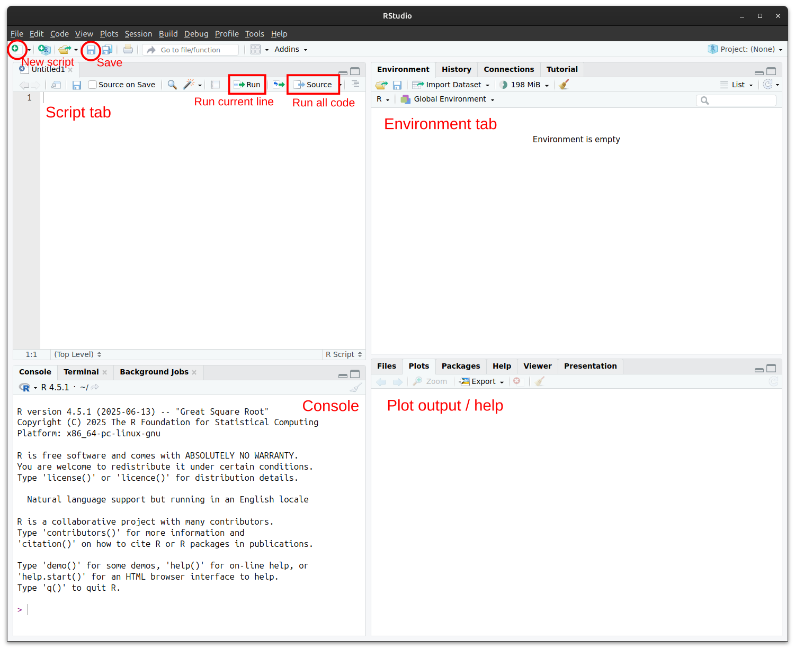

## Recap of material covered

This week you’ve seen why biologists need statistics, and how R will help us work with data.

-   **Why statistics?**\
    Biology is messy: organisms differ, environments vary, and measurements are never perfect. Statistics help us separate real patterns from chance, and the history of the field grew directly out of biological problems (think of "Student’s" t-test, or Fisher’s tea‐tasting experiment).

-   **Why R?**\
    R is a free and powerful tool for data analysis. Unlike point-and-click software, R lets us write scripts that are reproducible, transparent, and easy to share. RStudio provides a user-friendly environment to organise code, results, and plots.

-   **Why the tidyverse?**\
    The tidyverse is a set of R packages that makes data handling easier. With it you can quickly import your data, clean and reshape it, calculate summaries, and create clear, publication-quality plots.

This worksheet gives you hands-on practice with these ideas. You’ll start with R as a calculator, create objects and vectors, and then use tidyverse functions to organise, summarise, and visualise data.

## Before you begin

-   Make sure you have both **R** and **RStudio** installed. Get them from here: <https://posit.co/download/rstudio-desktop/>
-   Open RStudio. You should see four main panels: *script editor*, *console*, *environment/history*, and *plots/files/packages/help*.

::: callout-note
### Note

R and RStudio are free (*libre* and *gratis*). R is maintained by the Comprehensive R Archive Network. RStudio Open Source Edition is provided by posit. Although posit does offer some paid-for services, these are not helpful for your participation in the unit, nor for during your research projects.

:::

------------------------------------------------------------------------

## Getting started with RStudio

Follow these steps to set up your first R session.

1.  **Open RStudio**
    -   Find and launch RStudio on your computer.\
    -   You should see four main panels:
        -   *Script editor* (top left)\
        -   *Console* (bottom left)\
        -   *Environment/history* (top right)\
        -   *Files/plots/packages/help* (bottom right)
        
Your RStudio environment should look something like this. Key areas are highlighted here:


2.  **Create a new script**
    -   Go to **File → New File → R Script** or click the 'new script' button.\
    -   A blank script window will appear in the top left.\
    -   This is where you’ll write and save your code.
3.  **Save your script**
    -   Save your file with a meaningful name (e.g. `intro_practical.R`).\
    -   R scripts have the extension `.R`.\
    -   Save by pressing **Ctrl + S** (Windows/Linux) or **Cmd + S** (Mac), or click on the blue "disk" icon (similar to this emoji: 💾). Make sure you save regularly!
4.  **Run your first command**
    -   Type `2 + 2` into the script editor.\
    -   Highlight it and press **Ctrl + Enter** (Windows/Linux) or **Cmd + Enter** (Mac).\
    -   The result will appear in the **console**.
5.  **Add comments**
    -   Start a line with `#` to add a note to yourself.\

    -   Example:

        ``` r
        # This line calculates 2 + 2
        2 + 2
        ```
6.  **Check your workspace**
    -   Look at the *Environment* panel (top right).\
    -   Any objects you create (like variables or data tables) will appear here.
7.  **Install a package (only once)**
    -   In the console, type:

        ``` r
        install.packages("tidyverse")
        ```

    -   This downloads the tidyverse package.
8.  **Load a package (every session)**
    -   In the console or script, type:

        ``` r
        library(tidyverse)
        ```

    -   Now the tidyverse functions are ready to use.

👉 You are ready to start the worksheet!

::: callout-tip
### Tip

If you hover your mouse in code boxes that appear on the worksheet, a 'Copy to clipboard' button will appear in the top right corner. You can also select code and copy/paste it into your RStudio script window in the normal way. However, you might find that you retain a better understanding of what you are doing if you type out the commands instead.

:::
------------------------------------------------------------------------

### Objective 1. Learn how to use R as a calculator

Try typing these into the **console** and see what happens.

``` r
2 + 2
6 * 7
(5 + 3) / 2
```

> 📝 **Tasks:** Perform the following calculations:  
> - 12\^2\
> - the square root of 225 (`sqrt()`)\
> - the log base 10 of 1000 (`log10()`)

------------------------------------------------------------------------

### Objective 2. Creating objects in R

Objects let you store values and use them later. For example:

``` r
x <- 42
y <- sqrt(x)
y

# Delete (remove) the object y
rm(y)
```

> 📝 **Tasks:**\
> - Create an object called `age_y` with your age in years.\
> - Calculate your age in months and save it as `age_months`.
> - Delete the object `age_y`

------------------------------------------------------------------------

### Objective 3. Vectors in R

Vectors are a type of R object that holds multiple values.

``` r
height_m <- c(1.6, 1.7, 1.8, 1.65, 1.75)
mean(height_m)
```

> 📝 **Tasks:**\
> - Create a new vector called `weight_kg` with 5 values.\
> - Use `mean()` and `sd()` to calculate the average and variation of `height_m` and and `weight_kg`.\
> - What happens if you try `height_m + weight_kg`? Does this make any sense?
> - Calculate `BMI <- (weight_kg) / height_m ^2`

------------------------------------------------------------------------

### Objective 4. Extending R functionality through packages and the tidyverse

The **tidyverse** is a collection of packages that make R easier to use.

``` r
# install.packages("tidyverse")  # only needed the first time you use a package
library(tidyverse)               # every time you start R
```
You can also install packages using **Tools** → **Install packages...** and typing in the package name

Other packages we will use in this unit include `lme4` and `nlme`

> 📝 **Tasks:**\
> - Install `lme4` using `install.packages(lme4)`.  
> - Install `nlme` using **Tools** → **Install packages...**.  
> - Reflect: which method do you prefer? Which method do you think allows for greater reproducibility? (Hint: one method you can record in your R script, the other you cannot.)

------------------------------------------------------------------------

### Objective 5. Using tibbles to store data

Tibbles are another type of object in R. We typically use tibbles to store data. A tibble is like a spreadsheet, where different columns represent different types of data, and rows represent different data points. If you've used base R in the past, this is similar to a data.frame, only with slightly tweaked features.

Let's create a tibble of the height and mass of four students:

``` r
students <- tibble(
  name = c("Alice", "Ben", "Cara", "Dan"),
  height_m = c(1.62, 1.74, 1.80, 1.32),
  weight_kg = c(54, 68, 72, 50)
)
students
```

To access one column of a tibble, we can use the `$` notation

``` r
students$height_m     # Will return the vector height_m
students$weight_kg    # Will return the vector weight_kg
```

> 📝 **Tasks:**\
> - Use `mean()` and `sd()` to calculate the average and standard deviation of `height_m` and and `weight_kg`.\
> - Calculate BMI  using `students$height_m` and `students$weight_kg^2`

------------------------------------------------------------------------

### Objective 6. Getting a grip on pipes

Pipes are special operators that send objects to functions, or the output of one function to another function. Let's try some examples:

Return a tibble with just student names and heights:
``` r
students |>
  select(name, height_m)
```

Add a new column called `BMI` to data. Remember that you need to store the new object you've created--otherwise, you are only printing it to the screen.
``` r
students <- data |>
  mutate(BMI = weight_kg / height_m^2)
```

> 📝 **Task:**\
> - Use the pipe and `select()` to select only the columns containing height and weight from data.  
> - Use the pipe and `filter()` to create a new tibble containing only people taller than 1.7m.  
> - Use the pipe and `mutate()` to create a new column containing height in inches (1 inch = 2.54 cm).  

::: callout-tip
### Tip

Recall that `mutate()` allows us to make new columns, and `filter()` allows us to retain only rows that match certain characteristics.

💡 Remember: you can enter `?function_name` in the console (e.g. `?mutate`) to bring up the help file and remind yourself what a function does.
:::


<!--
------------------------------------------------------------------------

## 6. Plotting with ggplot2

R using the `ggplot2` library can create some complex and compelling graphics. We'll look at this more next week, but a good habit in data analysis is to look at your data. With real data, this will help you identify if there are any potential mistakes, e.g. with data entry.

```r
ggplot(data, aes(x = height_m, y = weight_kg)) +
  geom_point()
```

> 📝 **Task:**\
> - Make a scatterplot of `height_m` vs `weight_kg`.\
> - Add colour by `name`.\
> - Do you notice any potential outliers?\
> - Save the plot with `ggsave("height-vs-weight.pdf")`. Open the file in your operating system and inspect the contents.
-->

------------------------------------------------------------------------


## ❓Challenge questions

Use what you’ve learned this week to complete the following questions. Remember to use the script editor and to save your code as a `.R` script.

::: callout-note
## BIOL65161 students only
Normally you will upload your saved `.R` script to Canvas **before 5PM on the day of the practical**. However, this is not required for the intro practical.
:::

#### Question 1:

Create a numeric vector of at least 10 values representing measurements (e.g. weights of mice).\
1. Calculate the mean, median, and standard deviation.\
2. Use logical operators to identify which values are greater than the mean.\
3. Plot a basic histogram of your values using `hist()`.

------------------------------------------------------------------------

#### Question 2:

1.  Create a new tibble with at least 6 rows of your own made-up data (e.g. plant growth under different watering treatments).
2.  Add a new calculated column of your choosing. Remember you need to assign the new output to an object name!
3.  View the new tibble by clicking on it in the environment viewer.

------------------------------------------------------------------------


#### Question 3:

Make a tibble recording the heights and sexes of 8 imaginary plants.\
1. Add a new column that converts height from cm to m using `mutate()`.\
2. Use `group_by()` and `summarise()` to calculate the mean height for each sex.\

------------------------------------------------------------------------

#### Question 4:

1.  Create a tibble of 12 students with columns for `name` and `favourite_colour`.\
2.  Use `count()` to tally how many students chose each colour.\
3.  Which colour was most popular?

------------------------------------------------------------------------

#### Question 5:

Work with a built-in example dataset, Edgar Anderson's Iris Data, `iris`, which gives the measurements in centimeters of the variables sepal length and width and petal length and width, respectively, for 50 flowers from each of 3 species of iris. The species are Iris setosa, versicolor, and virginica.

1. Load the dataset `iris` with `as_tibble(iris)`. Don't forget to assign it a name using the assignment operator `<-`.\
2. Inspect the new dataset object you created.\
3. Use `select()` to retain only the columns `Sepal.Length`, `Petal.Length`, and `Species`.\

------------------------------------------------------------------------


## Recap: this week you've practiced

- How to use R as a calculator and create objects  
- How to work with vectors and basic functions like `mean()` and `sd()`  
- How to install and load packages, including the tidyverse  
- How to create and explore tibbles to store data  
- How to use pipes (`|>`) with functions such as `select()`, `filter()`, and `mutate()`  

These steps form the foundation for reproducible data analysis in R, which we will build on in later practicals.


