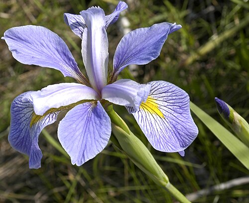

## Practical info

This worksheet will help practice fitting and using **linear models**.
It will use ideas previously introduced e.g. about **hypothesis
testing** — including the null hypothesis, *p*-values and their
interpretation. It will implement the approaches described in the videos
using **real data and R code**.

We'll focus this time on plant data sets `trees` and `iris`both
available in R

::: callout-note
## BIOL65161 students

Please upload your saved `.R` script to Canvas **before 5PM on the day
of the practical**.
:::

------------------------------------------------------------------------

## Part 1: Loading and visualising the `trees` data

`trees` is a dataset within R

### 1.1 Load up the data

load and take a first look at some of the data

```{r, echo = T, warning = F, message = F}
# Load the packages we're going to use today
# Use install.packages("...") if not already installed

library(tidyverse)
library(nlme)
library(GGally)

# Take a look at the data
trees |> 
  as_tibble()

# Take a look at the help file to see what the columns each mean
?trees
```

All three variables come through as the same type

#### Q1.1.1 What is the columns' variable type and is it appropriate?

For reference here is a table of possible data types:

| **Category** | **R Type/Class** | **Description / Example Usage** |
|------------------|----------------------|--------------------------------|
| **Numeric** | `numeric`, `integer`, `double` | Continuous or count data, e.g. measurements, ages, weights. |
| **Logical** | `logical` | TRUE/FALSE values for conditions or binary flags. |
| **Categorical** | `factor`, `ordered` | Discrete categories or ordinal scales (e.g. sex, treatment). |
| **Text** | `character` | Plain text strings. |
| **Date / Time** | `Date`, `POSIXct`, `POSIXlt` | Calendar dates and timestamps. |
| **Complex Numbers** | `complex` | Numbers with real and imaginary parts (rarely used). |
| **Raw Data** | `raw` | Byte-level data, e.g. binary representations. |
| **Containers** | `list`, `data.frame`, `tibble`, `matrix` | Structures for grouping multiple variables or elements. |

#### Q1.1.2 What simple analysis or hypothesis test might we do on this data? -- Try doing that analysis

Think back to options from the last session...don't spend too much time
on this!

#### Q1.1.3 What might we think of as response and explanatory variables here?

Think about why this data was collected and what they might have been
able to control in collecting the data.

### 1.2 Visualise the data

#### Q1.2.1 Make a plot showing all three variables in an appropriate way

## Part 2: Fitting a linear model

### 2.1 fit a linear model of volume as a function of girth

And then check its diagnostic plots

```{r, echo = T}

model_vg <- lm(Volume ~ Girth, data = trees)
plot(model_vg)

```

#### Q2.1.1 What do you make of the diagnostics plots and what might you do about it?

Now look at the summary of the model

```{r, echo = T}
summary(model_vg)
```

Notice the R-squared value, i.e. the proportion of variance explained,
is very high (0.93)

#### Q2.1.2 Figure out the best estimate, error and units for how much volume increases with girth

### 2.2 Visualise the fit

Want to see what's going on -- by default the `predict` function gives
the value predicted by the model at the same points as you have data, so
you can create a new column of precitions:

```{r, echo = T}
trees |> 
  mutate(pred = predict(model_vg)) |> 
  ggplot(aes(x = Girth, y = Volume)) +
  geom_point() +
  geom_line(aes(y = pred))+
  theme_classic()
```

#### Q2.2.1 Try re-plotting the data and fit with two logarithmic axes -- how does this make you feel about doing a log-log (power law) fit instead?

If in doubt how to do it, ask your favourite large language model!

## Part 3: Comparing models

### 3.1 Adding another *main effect* and an *interaction effect*

This regression model explains lots of the variance, but wouldn't we
expect tree height to tell us something useful about the volume too?

Let's fit a model containing both Girth, Height and their interaction:

```{r, echo = T}
model_vghi <- lm(Volume ~ Girth * Height, data = trees)
```

Decide if we need that interaction effect -- can check using anova:

```{r, echo=T}
anova(model_vghi)
```

That says that the interaction between girth and height is highly
significant ($p = 7.5 \times 10 ^{-6})$)

#### Q3.1.1 Can you test the significance of the girth:height interaction term in a different way?

#### Q3.1.2 What proportion of the variance in volume is explained by this model?

#### Q3.1.3 Check the diagnostic plots for the model and plot the predicted values with the data - what do you conclude?

### 3.2 Thinking about model simplification

If losing the interaction effect hadn't made the model significantly
worse, we could have removed it and then, tried removing one of the main
effects (height or girth) too, picking the one where the effect was
least significantly different from zero.

This kind of sequential simplification can help make complex models much
more interpretable, but needs to be done carefully -- effects shouldn't
be removed if they are required by (higher order) interactions. And it's
always the least significant effect that should be removed first,
comparing models with and without the effect after every removal. Such
stepwise simplification and comparison can be done by AIC - checking the
AIC of each model with one effect that can be removed, removed. The
better model -- the one with the lower AIC -- is chosen and the process
is repeated.

The `step()` function does this in an automated way:

```{r, echo = T}
step(model_vghi)
```

Here we see that the starting model (in the row \<none\> because none of
the effects was removed) has a lower AIC (65) than a model with the
Girth:Height interaction removed (AIC = 87), showing that the
Girth:Height interaction should be kept. `step` doesn't try removing the
main effects of either Girth or Height, because they're each involved in
the Girth:Height interaction, so that interaction would need to be
removed first. The output lines below this, starting with "Call" show
the final, reduced model that is returned -- here it's the same model
that we started with.

## Part 4: Linear modelling with a categorical explanatory variable

Using `iris` a classic dataset of measurements from three species of
iris.

::: {#fig-irises layout-ncol="3"}
{#fig-setosa style="height:160px; object-fit:cover;" .lightbox}

{#fig-versicolor style="height:160px; object-fit:cover;" .lightbox}

{#fig-virginica style="height:160px; object-fit:cover;" .lightbox}

Iris species represented in the `iris` dataset.
:::

### 4.1 take a first look at the data and wrangle it

Take a first look at some of the data, which contains five variables.
Also check the help file.

```{r, echo = T, warning = F, message = F}
ggpairs(iris)
?iris
```

Could think about this in different ways, but here we're going to think
about how different species have different measurements - species is the
explanatory variable, measurement is the response. This means that, to
get long-format data, all the different measurements of different
structures can be stacked up in a single column:

```{r, echo = T}
# As it happens all the measurement columns have a dot in the middle - let's use that to identify them and stack them up:
iris_stacked <- iris |> 
  pivot_longer(contains("."), 
               names_to = "structure_measured", 
               values_to = "measurement")
iris_stacked
```

#### Q4.1.1 Look at the data types for the different columns -- what are they? Why are they all different? Do they need to be?

#### Q4.1.2 Plot out the full dataset and comment on what it looks like

Start by plotting however you can. Then try to do a version involving
the measured structure on the x axis and separate facets for each
species using `facet_wrap()`. Ask a large language model how to angle
your axis text so that it doesn't overlap

### 4.2 fit a linear model with both explanatory effects and their interaction

```{r, echo = T}
model_ssi <- lm(measurement ~ Species * structure_measured, data = iris_stacked)
```

#### Q4.2.1 Check the diagnostic plots and summary -- is this model ok?

What might you consider changing?

## Part 5: Fit a revised linear model that doesn't assume homoscedasticity

For this will need to use the `gls()` function in the `nlme` package.
gls stands for 'generalized least squares' it lets us relax some of the
strict assumptions in a normal linear model.

### 5.1 Fit exactly the same model as we fitted with `lm()`, but with `gls()`

```{r, echo = T}
model_ssi_g <- gls(measurement ~ Species * structure_measured, 
                   data = iris_stacked)
```

#### Q5.1.1 Compare the models fitted by `lm` and `gls` -- convince yourself that the underlying model is the same and use tools you know about (e.g. `plot()`, `summary()`, `anova()`) to compare how they are presented.

The models can be directly compared via `anova`, showing that the fit of
the two models is equivalent

```{r, echo = T}
anova(model_ssi_g, model_ssi)
```

### 5.2 Fit a model where the variance can change with the fitted value

There are different ways we could imagine the variance changing, so
there are several different variance structures available that we could
try (see `?varClasses`), but `varPower` is one that, by default, allows
variance to change as a power function of the fitted value. It often
does a good job. Slightly oddly, it is given as the `weights` argument:

```{r, echo = T}
model_ssi_gv <- gls(measurement ~ Species * structure_measured, 
                    weights = varPower(), 
                    data = iris_stacked)

```

If we now examine the fit (just printing the model here, though could
use `summary()` to get more output), can see that it's fitted an extra
parameter `power`:

```{r, echo = T}
model_ssi_gv
```

The fitted value of power is 0.54. That's positive, meaning that the
variance is increasing with the fitted value as we saw in the `lm` fit.
Since this is a power function, that means that variance is increasing
roughly with the square root of the fitted value.

#### Q5.2.1 Compare the two `gls` models using `anova()` -- the one with the changing variance and the one without -- does this extra parameter make the model better, any more than would be expected just by having a more complex model?

#### Q5.2.2 Look at the summaries of the models with and without the variance effect - what has and what hasn't changed among the parameters?

Because the estimates of the coefficients haven't changed, we might
expect the residuals plots to look the same too, but they don't. This is
because the residuals plots show 'Standardised residuals'. That means
that the residuals have been scaled by the expected variance, which is
different in the two models, so we can inspect them to see if the model
is now ok.

#### Q5.2.3 Look at the residuals plots for this heteroscedastic model -- are they better? Are there other aspects that could still be improved?

#### Q5.2.4 Redo your plot of the data from Q4.1.2, but add on blobs for the predicted values from `model_ssi_gv` and give it a squareroot y-axis using `scale_y_sqrt()`, which we now expect to make the variance look similar across all the data.

#### Q5.2.5 Look at the coefficients of the model. The Wald tests on ALL of them are significant, meaning that the coefficients themselves are significantly different from zero, but try figuring out exactly what biological hypothesis is being tested by the first of the interaction terms.

------------------------------------------------------------------------

## Part 6: Reflection

-   What we've done with this `iris` analysis would be called a
    **two-way ANOVA** because there are two categorical explanatory
    variables -- species and structure measured, whereas the trees
    analysis would be called a **multiple regression** because there are
    two continuous explanatory variables. However, what we've done in
    both cases is very similar and the mechanics of how R has done the
    analysis is very similar, so it's often best just to refer to both
    of them as **linear models**

-   All the effects in both of these models were highly significant, so
    while you probably would need to report the *p*-values for the
    effects (girth or height; structure_measured or species), the use of
    the analysis has much more to do with what the parameters are, what
    the predictions are, how much variance is explained and what that
    variance is like.

-   In the `iris` analysis you might still have questions about whether
    particular structures are significantly different from one another
    e.g. *versicolor* sepal width versus *virginica* sepal width. The
    best way to go about this is to have hypotheses you want to ask
    clear before you start the analysis and arrange the levels of the
    factors (e.g. using `relevel()` to make versicolor and sepal width
    the to be the reference levels of species and structure_measured) so
    that the Wald test tests your hypothesis. This is called using
    **planned contrasts**. There are ways of doing such comparisons once
    you've got your model too, these are called **posthoc tests**.

-   Often posthoc tests make all possible comparisons -- this is usually
    a bad idea, because we usually have some sort of idea what we're
    looking for and if we do enough tests a small proportion of them
    will come out significant just by chance. If you really want to do
    posthoc tests, e.g. with the `emmeans` or `multcomp` packages, use
    what you know about the comparisons, e.g. if you have a control
    treatment, you might only want to compare each treatment to the
    control, not everything to everything, using **Dunnett's test**. If
    you really do want to compare everything to everything else, at
    least do it 'honestly' using **Tukey's HSD** (honest significant
    difference) test which accounts for doing lots of tests. Both are
    available in `emmeans` and `multcomp`.

-   The fact that the two categorical variables in the `iris_stacked`
    tibble had different classes didn't cause problems for either the
    plotting or the analysis. However, if we start to modify those
    variables, for example to change the reference level with relevel(),
    that will work on a factor column (Species), but not a character
    column (structure measured), which would need to be changed into a
    factor column e.g. with
    `mutate(structure_measured = as.factor(structure_measured) |> relevel(ref = "Sepal.Width"))`)
